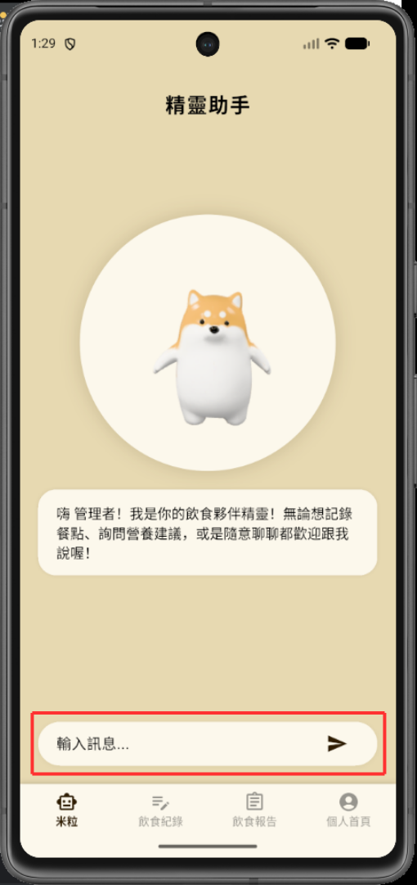
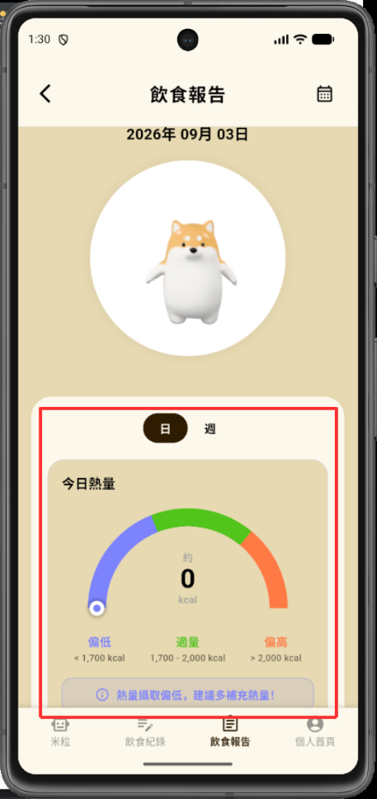
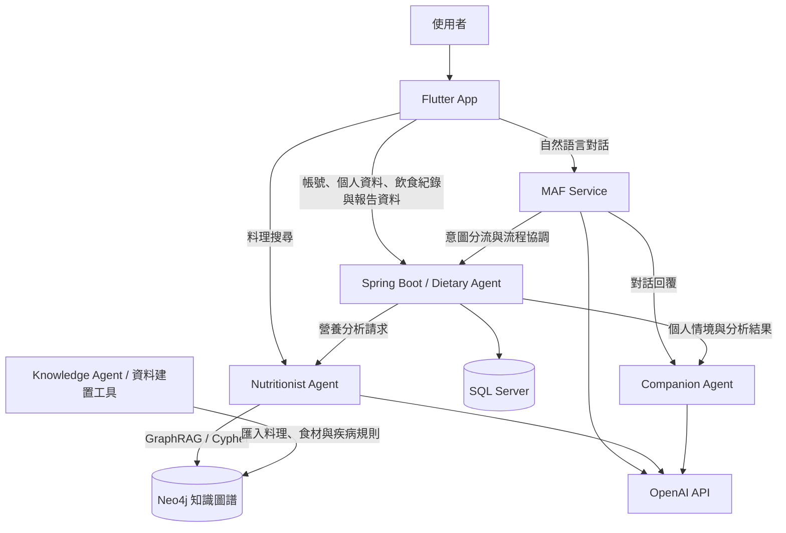
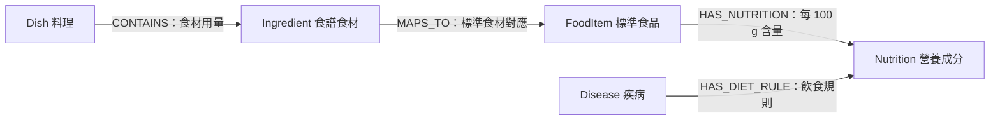

<p align="center">
  
</p>

# 食伴｜AI 多代理人個人化飲食建議系統

**陪你吃好每一餐，也陪你過好每一天。**

食伴是一款面向臺灣外食情境的飲食管理 App，結合 **多代理人協作、GraphRAG 知識圖譜檢索與 3D 小精靈互動**。使用者可以在點餐前詢問料理是否適合自己，餐後透過對話或手動方式記錄飲食，再以日報告與週報告回顧營養攝取狀況。

系統整合個人基本資料、健康狀況、飲食目標及近期飲食紀錄，提供料理營養估算、選擇理由與調整建議，並以小精靈的對話、動畫及體態變化，增加日常記錄的互動性。

> 專題名稱：以 AI 多代理人架構，實現個人化營養補給推薦系統

## 目錄

- [專案特色](#專案特色)
- [操作畫面](#操作畫面)
- [主要功能](#主要功能)
- [系統架構](#系統架構)
- [知識圖譜與營養分析](#知識圖譜與營養分析)
- [小精靈體態機制](#小精靈體態機制)
- [技術組成](#技術組成)
- [專案結構](#專案結構)
- [本機執行](#本機執行)
- [成果與限制](#成果與限制)
- [未來規劃](#未來規劃)
- [開發團隊](#開發團隊)

## 專案特色

- **餐前飲食決策**：輸入料理名稱與份量，即可詢問單道料理或比較多道餐點，取得適合程度、判斷理由與調整方式。
- **結合個人情境**：納入健康條件、飲食目標與最近七天的飲食紀錄，作為建議依據。
- **以知識圖譜支援分析**：串接料理、食材、標準食品、營養素及疾病飲食規則，讓營養分析具有可追溯的資料關係。
- **對話式飲食紀錄**：從自然語言擷取餐點、份量、日期與餐別，先提供草稿，經使用者確認後再儲存。
- **3D 小精靈陪伴**：以狗狗角色呈現待機、思考、回覆與進食動畫，並依飲食紀錄更新角色體態。

## 操作畫面

以下為 App 內使用說明所使用的畫面，紅框標示主要操作區域。

|                                               小精靈對話                                                |                                               飲食報告                                               |
| :-----------------------------------------------------------------------------------------------------: | :--------------------------------------------------------------------------------------------------: |
|  |  |

## 主要功能

| 功能           | 說明                                                                   |
| -------------- | ---------------------------------------------------------------------- |
| 帳號與個人檔案 | 註冊、登入、登出，以及生日、身高、體重、健康狀況、飲食目標與頭像設定。 |
| AI 飲食諮詢    | 透過小精靈對話查詢料理營養、比較餐點，取得個人化飲食建議。             |
| 飲食紀錄       | 搜尋料理、設定份數與餐別、上傳餐點照片，並新增、修改、刪除或查詢紀錄。 |
| 自訂料理       | 保存個人輸入的料理及營養資訊，方便後續記錄。                           |
| 飲食日記與報告 | 依日期及餐別查看紀錄，以日／週報告呈現熱量與營養攝取情形。             |
| 小精靈互動     | 記錄完成後播放進食動畫，依每日結算結果呈現不同體態。                   |
| 問題回饋       | 提交問題文字與附圖，查看管理者回覆。                                   |
| 管理功能       | 處理使用者回報，測試小精靈體態轉換動畫與飲食總結報告。                 |

### 使用流程

1. 註冊帳號並完成個人資料與健康條件設定。
2. 用餐前向小精靈提問，例如：「雞腿便當和牛肉麵，哪個比較符合我的目標？」
3. 用餐後以對話或手動方式記錄餐點；對話產生的紀錄草稿需確認後才會寫入。
4. 查看飲食日記、日報告與週報告，掌握近期攝取情形。
5. 下次開啟 App 時，由系統結算尚未結算的日期，更新小精靈體態。

## 系統架構

 
 


### 代理人分工

| 元件                   | 職責                                                                                                                      |
| ---------------------- | ------------------------------------------------------------------------------------------------------------------------- |
| **MAF Service**        | 使用 Microsoft Agent Framework 協調流程，分析意圖、情緒、料理、份量與日期，分流至一般聊天、飲食建議、飲食紀錄或紀錄查詢。 |
| **Dietary Agent**      | 實作於 Spring Boot 的 `DietaryAgentService`，取得登入使用者的個人資料與近期紀錄，串接營養分析及陪伴服務。                 |
| **Nutritionist Agent** | 檢索知識圖譜、換算料理營養、整合疾病規則與個人情境，產生分析及建議。                                                      |
| **Companion Agent**    | 將個人情境與分析結果轉為自然中文回覆，依情緒資訊調整表達方式。                                                            |
| **Knowledge Agent**    | 負責資料整理與知識圖譜匯入，屬於資料建置流程，並非每次對話都會執行的服務。                                                |

## 知識圖譜與營養分析

知識圖譜以料理與食材的對應關係為基礎，整合食品營養資料與疾病飲食規則：



分析時，系統先比對料理名稱，透過 Cypher 查詢圖譜，必要時使用 Text-to-Cypher 輔助檢索；再依食材用量與餐點份數計算營養，最後結合健康條件及近期飲食紀錄產生建議。

資料建置來源包含臺灣食品營養成分資料庫、公開食譜、店家公開營養資訊，以及每日飲食指南與慢性病飲食相關手冊。部分外食食譜由公開營養資訊輔助推估組成。

依專題文件記載，成果階段共收集 **3,054 份食譜、3,637 種食材與 10 種疾病規則**，知識圖譜共 **9,196 個節點**。這些數字為文件記錄的建置成果；目前儲存庫未附完整原始資料或 Neo4j 資料庫備份。

## 小精靈體態機制

小精靈以 `BodyScore` 與 `MuscleScore` 呈現飲食紀錄的累積變化，兩者初始值均為 50，分數範圍為 0–100。

- **BodyScore**：依每日攝取熱量與系統建議熱量的差距調整。
- **MuscleScore**：依每日蛋白質攝取達成率調整。
- **每日結算**：於之後開啟 App 時處理尚未結算的日期；體態改變時播放轉換動畫。
- **補登處理**：過去日期的紀錄仍會保存，但已完成結算的日期不會重新計分。

| 體態 | 判定條件                                      |
| ---- | --------------------------------------------- |
| 胖   | `BodyScore >= 70`，優先於其他條件。           |
| 壯   | `BodyScore < 70` 且 `MuscleScore >= 70`。     |
| 瘦   | `BodyScore <= 30` 且 `MuscleScore < 70`。     |
| 標準 | `30 < BodyScore < 70` 且 `MuscleScore < 70`。 |

這些分數是 App 的角色互動規則，用來回饋記錄行為與攝取情形，並非對使用者實際體脂或肌肉量的測量。

## 技術組成

| 層級       | 技術與用途                                                              |
| ---------- | ----------------------------------------------------------------------- |
| 行動端     | Flutter、Dart、Material Design。                                        |
| 核心後端   | Java 21、Spring Boot 4.0.3、Spring Security、Spring Data JPA。          |
| 身分驗證   | JWT、Refresh Token、BCrypt 密碼雜湊。                                   |
| 代理流程   | Python、Microsoft Agent Framework、FastAPI、Uvicorn。                   |
| 營養分析   | Python、GraphRAG、Cypher、OpenAI API。                                  |
| 陪伴服務   | Node.js、Express、OpenAI API。                                          |
| 資料儲存   | SQL Server 儲存應用資料；Neo4j 儲存知識圖譜；Flyway 管理 SQL 結構遷移。 |
| 角色與動畫 | Tripo3D、Blender、Mixamo；Flutter 以 `model_viewer_plus` 呈現模型。     |
| 服務部署   | Docker、Docker Compose。                                                |

## 專案結構

```text
dietary_app/
├── frontend/                    # Flutter App、圖片、3D 模型與動畫資源
│   ├── lib/                     # 畫面、服務、模型與互動邏輯
│   ├── assets/                  # 視覺與模型素材
│   └── third_party/             # 專案使用的 model_viewer_plus 修補版本
├── backend/                     # Spring Boot 核心 API 與 Dietary Agent
│   └── src/main/resources/db/migration/  # Flyway SQL 遷移腳本
├── MAF/                         # 多代理人工作流程、意圖分流與紀錄確認
├── companion/                   # Node.js 陪伴代理人與提示詞
├── graphRag/
│   ├── nutritionist_agent/      # GraphRAG 檢索、營養計算與分析 API
│   └── kg_builder/              # 知識圖譜建置與匯入工具
├── dietary-advice/              # 食譜蒐集與資料轉換工具
├── blender/                     # 角色製作相關素材
├── docker/                      # 各服務的 Dockerfile
└── compose.yaml                 # 四個後端服務的容器設定
```

## 本機執行

以下以 **Windows、Docker Desktop 與 Android 裝置／模擬器** 為例。指令從專案根目錄開始執行。

### 1. 準備環境與資料庫

- 安裝 Docker Desktop，使用 Linux containers，確認可執行 `docker compose`。
- 安裝 Flutter 與 Android SDK；目前 `pubspec.yaml` 要求 Dart `^3.10.1`。
- 準備可連線的 SQL Server，建立名為 `dietaryApp` 的空資料庫，並提供具有執行結構遷移權限的帳號。
- 準備 Neo4j，匯入料理、食材、營養與疾病規則資料。
- 準備可用的 OpenAI API Key，確認帳號可使用設定的模型。

**目前 `compose.yaml` 只啟動 Nutritionist、Backend、Companion 與 MAF 四個服務；SQL Server、Neo4j 與 Flutter App 需另外準備。** 後端啟動時會透過 Flyway 建立或更新應用資料表。

#### 知識圖譜資料準備

若使用專案的匯入工具，需另備以下資料。路徑以目前匯入程式的預設設定為準，位於專案根目錄的 `data/`：

```text
data/
├── recipe_and_nutrition/
│   ├── recipes_json/
│   ├── nutrition_data_categorized.json
│   └── nutrition_components.json
└── disease_and_biomarker/
    └── chronic_disease_rules_v2.json
```

資料格式與可覆寫的輸入路徑請參考 [knowledge_agent_importer.py](graphRag/kg_builder/knowledge_agent_importer.py)，圖譜結構可參考 [neo4j_schema_current.cypher](graphRag/kg_builder/neo4j_schema_current.cypher)。資料備妥後，可在 Python 3.12 虛擬環境中安裝並執行匯入工具：

```powershell
python -m venv .venv
.\.venv\Scripts\python.exe -m pip install -r graphRag/kg_builder/requirements.txt
$env:NEO4J_URI = "bolt://localhost:7687"
$env:NEO4J_USER = "neo4j"
$env:NEO4J_PASSWORD = "your-neo4j-password"
.\.venv\Scripts\python.exe graphRag/kg_builder/knowledge_agent_importer.py
```

### 2. 設定環境變數

在專案根目錄建立 `.env`，填入實際連線資訊。若已有設定檔，請調整既有內容。

```dotenv
OPENAI_API_KEY=your-openai-api-key

DB_USERNAME=sa
DB_PASSWORD=your-sql-server-password
BACKEND_DB_URL=jdbc:sqlserver://host.docker.internal:1433;databaseName=dietaryApp;encrypt=true;trustServerCertificate=true

NEO4J_USER=neo4j
NEO4J_PASSWORD=your-neo4j-password
NEO4J_AGENT_URI=bolt://host.docker.internal:7687

JWT_SECRET=replace-with-a-random-secret-at-least-32-bytes-long
```

將範例值替換為實際設定；`JWT_SECRET` 需使用至少 32 bytes 的隨機密鑰。`.env` 已由 `.gitignore` 排除。

Docker 內以 `host.docker.internal` 存取主機上的資料庫；若資料庫位於其他主機，請修改對應位址。`BACKEND_DB_URL` 是 Compose 使用的變數名稱，會傳入後端容器的 `DB_URL`。

可另外設定 `NUTRITIONIST_MODEL` 與 `COMPANION_MODEL` 覆寫模型；未設定時採用 [compose.yaml](compose.yaml) 中的預設值。請依 API 帳號實際可用的模型調整。

### 3. 啟動後端服務

```powershell
docker compose up --build -d
docker compose ps
```

| 服務         | 本機位址                    | 用途                                     |
| ------------ | --------------------------- | ---------------------------------------- |
| Backend      | `http://localhost:8080/api` | 帳號、個人資料、飲食紀錄及代理服務整合。 |
| Nutritionist | `http://localhost:8000`     | 營養分析與料理查詢。                     |
| Companion    | `http://localhost:3000`     | 陪伴回覆生成。                           |
| MAF          | `http://localhost:3001`     | 對話分流與工作流程。                     |

可使用下列端點檢查服務：

```powershell
Invoke-RestMethod http://localhost:8000/nutritionist-agent/health
Invoke-RestMethod http://localhost:8000/nutritionist-agent/ready
Invoke-RestMethod http://localhost:3000/health
Invoke-RestMethod http://localhost:3001/health
```

`health` 用於服務存活檢查，Nutritionist 的 `ready` 另檢查 Neo4j 連線；這些檢查不代表圖譜資料已完整匯入或 OpenAI 請求已成功。若服務啟動失敗，可執行 `docker compose logs --tail=100` 查看原因。

### 4. 執行 Flutter App

目前儲存庫包含 Android 平台專案。連接 Android 裝置或啟動模擬器後，使用 ADB 將 App 所需的連線轉送至開發電腦：

```powershell
adb reverse tcp:8080 tcp:8080
adb reverse tcp:8000 tcp:8000
adb reverse tcp:3001 tcp:3001

cd frontend
flutter pub get
flutter run --dart-define=API_BASE_URL=http://127.0.0.1:8080/api --dart-define=NUTRITIONIST_API_BASE_URL=http://127.0.0.1:8000
```

上述指令以 ADB 目前選定的裝置為對象，多裝置時需指定裝置。MAF 的連線位址由前端 API 設定推導，相關邏輯位於 [api_config.dart](frontend/lib/config/api_config.dart)。

Compose 預設將服務連接埠綁定在主機 `127.0.0.1`，適合以上本機轉送流程；若改用區域網路連線，需同步調整連接埠綁定、主機防火牆及 App API 位址。

## 成果與限制

專題完成飲食諮詢、紀錄管理、日／週報告與 3D 小精靈互動的整合。文件中的測試者問卷回饋指出，小精靈體態變化、對話式紀錄及飲食報告受到肯定；這些結果屬於使用體驗回饋，不等同於營養估算準確度的客觀驗證。

目前的主要限制包括：

- **外食配方差異**：同名料理在不同店家的份量、調味與烹調方式可能不同，參考食譜的營養估計無法完整代表實際餐點。
- **資料涵蓋範圍**：料理與食材是否收錄、名稱能否正確對應，都會影響查詢與分析結果。
- **疾病規則粒度**：目前以一般飲食原則為主，尚未完整涵蓋疾病程度、多重疾病與個人差異。
- **照片功能範圍**：目前可上傳餐點照片供紀錄使用；影像輔助辨識列於後續規劃。
- **外部服務依賴**：對話與分析需要資料庫及模型服務，回應速度會受到網路與推論時間影響。

## 未來規劃

- 擴充臺灣外食、店家餐點與疾病飲食規則資料，並邀請營養或醫療專業人員協助檢視。
- 改善料理名稱比對、食材對應及份量換算。
- 增加店家、醬料、配料與烹調方式等選填資訊，提升外食估算的適用性。
- 呈現營養估計範圍、資料來源與不確定性。
- 加入餐點影像輔助辨識，保留使用者確認及修改結果的流程。
- 優化代理服務回應速度，以及小精靈的情緒回應、動畫與長期互動設計。

## 開發團隊

- **指導教授**：鄭啟斌 老師
- **團隊成員**：江秉真、利蓁琳、陳冠華、黎蔓霓、黃鈺婷、李佳芮
- **專題年度**：115 學年度
- **競賽組別**：資訊應用組

## 授權

本儲存庫尚未提供專案整體的授權條款。第三方程式與素材依各自授權規定使用；隨附的 `model_viewer_plus` 授權見 [LICENSE](frontend/third_party/model_viewer_plus/LICENSE)。
