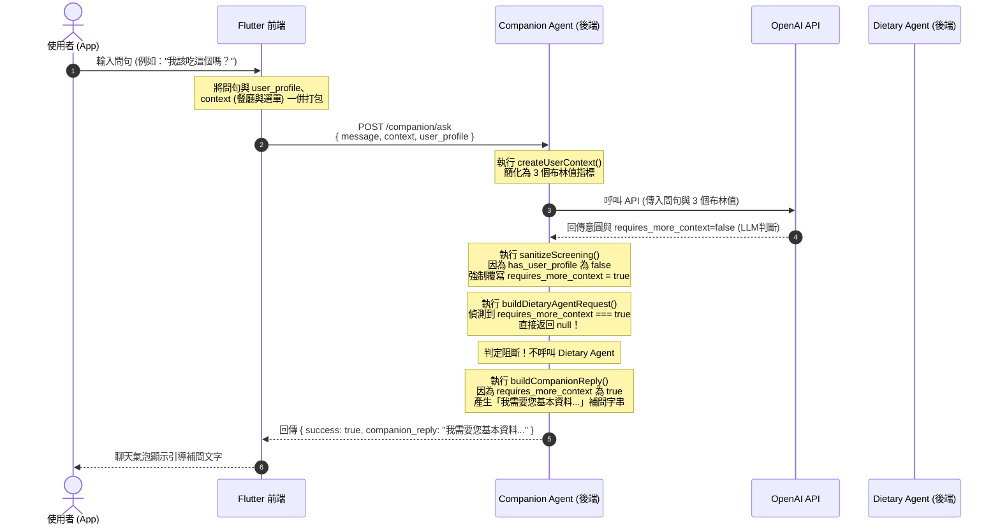

# 刪除與重構 `createUserContext` 評估報告

本文件詳細順理了 Companion Agent 現行的「引導補問機制」運作流程、該機制對傳遞參數給 Dietary Agent 的影響，並提供兩種後續重構的處理解決方案，協助您進行評估與抉擇。

---

## 1. 現行「引導補問機制」運作流程圖 (Sequence)

---

## 2. 為什麼它會直接影響傳給 Dietary Agent 的參數？

從上圖的 **第 7 步** 到 **第 9 步** 可以看出，這是一套「一條龍」的阻斷邏輯：

1. **資料缺失**：當前端沒有傳送 `user_profile` 時，`createUserContext` 會把 `has_user_profile` 標記為 `false`。
2. **強制覆寫**：後端硬編碼程式碼（Sanitize）會強制把 `requires_more_context` 覆寫為 `true`。
3. **參數歸零**：`buildDietaryAgentRequest` 只要看到 `requires_more_context === true`，就會**直接拒絕組裝參數**，回傳 `null`。
4. **阻斷傳遞**：因為參數為 `null`，主流程決定**不呼叫 Dietary Agent**，訊息完全無法往後傳。

---

## 3. 重構解決方案評估

為了實現**「前端只傳 prompt，其餘使用者資料都不傳」**的目標，我們有以下兩種處理方案：

### 方案 A：徹底刪除補問機制 (推薦 🌟)
完全移除 `user_profile`、`context` 檢查，同時廢除補問（`requires_more_context`）邏輯。

* **運作方式**：
  * 刪除 `createUserContext` 函數。
  * 刪除 `requires_more_context` 與 `missing_information` 欄位。
  * 傳給 OpenAI 的只有純文字的 `prompt`。
  * 若使用者輸入的 Prompt 語意不清、無法提取出任何食物，LLM 會將 `question_type` 歸類為 `"unknown"`，且 `dishes` 陣列為空。
  * 後端在參數檢查時（調整要求 4），會因為 `question_type === "unknown"` 或 `dishes` 長度為 0，而**直接攔截**不傳給 Dietary Agent，並在 `buildCompanionReply` 中回覆「我目前無法理解您的問題，請重新輸入」之類的一般回覆。
* **優點**：
  * 程式碼極度簡化，移除大約 40% 的冗餘邏輯。
  * 流程完全線性，除錯極度容易。
  * 節省發送給 OpenAI 的 Token。
* **缺點**：
  * Agent 失去「親切補問」的語氣，只會直接告訴使用者它無法處理。

---

### 方案 B：僅保留「語意模糊」的補問機制
移除對 `user_profile` 的依賴，但保留 `requires_more_context`，只讓 LLM 針對「問句本身是否過於模糊」進行補問。

* **運作方式**：
  * 刪除 `createUserContext`。
  * 傳給 OpenAI 的只有純文字 `prompt`。
  * 在 `SYSTEM_PROMPT` 中指示 LLM：「如果使用者的問句語意太過模糊，導致你無法判斷他想問什麼（例如只打了『我該怎麼吃』，但沒說吃什麼食物，也沒說是在減脂還是增肌），請將 `requires_more_context` 設為 `true`。」
  * 若 `requires_more_context` 為 `true`，`buildCompanionReply` 會回覆：「為了給您更合適的建議，可以再多提供一些您的飲食狀況或細節嗎？」
* **優點**：
  * 保留了 Agent 的引導互動性，能夠柔和地提醒使用者補充細節。
  * 依然達成了「前端只傳 prompt」的輕量化目標。
* **缺點**：
  * 後端仍需維護 `requires_more_context` 的判斷分支。

---

## 4. 後續處理建議

如果您希望**系統最乾淨、維護成本最低**，建議選擇 **方案 A**。

我們可以在重構時：
1. 直接在 `companion-agent.js` 中把 API 的參數縮減為單一 `prompt`。
2. 徹底移除 `createUserContext`。
3. 如果您選擇方案 A，我們也會一併把 `requires_more_context` 從 LLM 的 Schema 中拔除。
