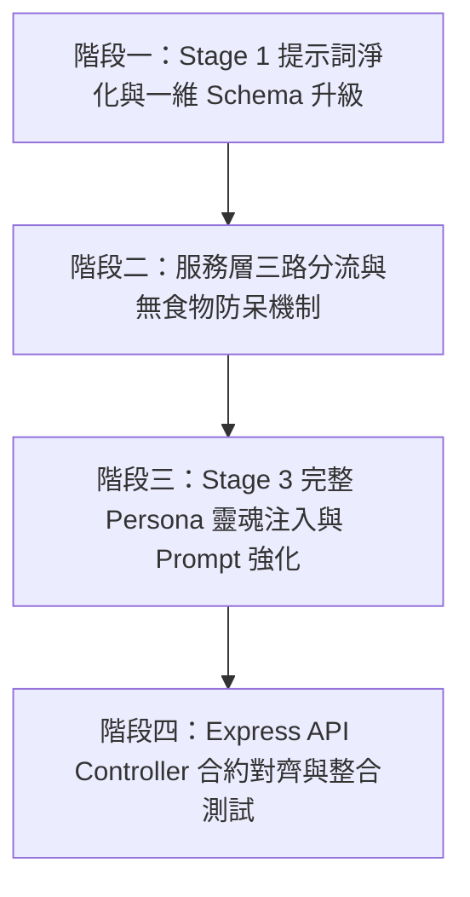

# Companion Agent Version 6 程式碼重構實作計畫說明書 (adjust_v6_implementation.md)

本說明書針對 `doc/companion_agent_structure_v2.md` 與 `doc/adjust_v6.md` 所規範之 **Companion Agent Version 6** 系統架構，對現有 3 個 Node.js 原始碼檔案進行完整之現況診斷、差異對照、具體修改細節與分階段重構計畫說明。

---

## 📌 一、 Architecture Flowchart 完整流程與現狀對照

依據 `companion_agent_structure_v2.md` 之流程圖，系統運作包含 **三次 API 呼叫** 與 **三路分流機制**：

```text
+-----------------------------------------------------------------------------------+
|                                 使用者輸入 (user_prompt)                             |
+-----------------------------------------------------------------------------------+
                                          |
                                          v
+-----------------------------------------------------------------------------------+
|                        【第 1 次 API】runLLMAnalysis                              |
|   - 意圖分類 (should_handle, intent_category, question_type)                       |
|   - 情緒診斷 (analyze_emotion, needs_empathy)                                     |
|   - 食物/份數/單位/餐期一維陣列抽取 (meal_items)                                    |
|   * 特色：純結構化 JSON，無 Persona，不生成自然語言對話                             |
|   * 附註：dish_info_list 為 Node.js 後端收到 meal_items 後自動提煉之衍生字典        |
+-----------------------------------------------------------------------------------+
                                          |
                                          v
                                    三路分流判斷
                                          |
        +---------------------------------+---------------------------------+
        |                                 |                                 |
        v                                 v                                 v
  【分流 A：閒聊 / 非飲食】           【分流 B：飲食紀錄】              【分流 C：飲食諮詢】
  (should_handle === false)     (intent_category ===         (intent_category ===
   或 general_chat)                "meal_record")               "dish_advice")
        |                                 |                                 |
        |                                 v                                 |
        |                         [ 整理/按餐期歸類 ]                       |
        |                         [   meal_items   ]                        |
        |                                 |                                 |
        |                                 v                                 |
        |                      +-----------------------+                    |
        |                      |  前端草稿彈跳視窗      |                    |
        |                      |  (Flutter Popup UX)   |                    |
        |                      +-----------------------+                    |
        |                                 |                                 |
        |                                 |                                 v
        |                                 |                     是否包含具體食物資訊？
        |                                 |                       /            \
        |                                 |                     否              是
        |                                 |                     /                \
        |                                 |                    v                  v
        |                                 |           [ 跳過 Java 與翻譯 ]    【第 2 次 API】translateDishes
        |                                 |                    |             (條件觸發：花俏/行銷菜名標準化)
        |                                 |                    |                  |
        |                                 |                    |                  v
        |                                 |                    |         [ 呼叫 Java Dietary Agent ]
        |                                 |                    |         (POST /dietary-agent/ask)
        |                                 |                    |                  |
        |                                 |                    |                  v
        |                                 |                    |         dietaryAgentResponse
        |                                 |                    |       (熱量與營養數據分析結果)
        |                                 |                    |                  |
        +---------------------------------+--------------------+------------------+
                                          |
                                          v
+-----------------------------------------------------------------------------------+
|                        【第 3 次 API】runLLMReply                                 |
|   - 小精靈本尊對話生成器 (100% 集中注入完整 Persona 靈魂)                         |
|   - 整合情境：                                                                    |
|     1) 閒聊導回同理對話                                                           |
|     2) 飲食紀錄確認與溫馨讚賞                                                     |
|     3) 無食物時親切引導補充                                                       |
|     4) 結合 Java 營養數據生成 50 大卡區間化建議與免責聲明                          |
+-----------------------------------------------------------------------------------+
                                          |
                                          v
+-----------------------------------------------------------------------------------+
|                            最終對話文字 (companion_reply)                          |
+-----------------------------------------------------------------------------------+
```

---

## 📌 二、 現狀診斷與核心指標綜合比較矩陣 (Comparison Matrix Table)

目前 companion 服務包含 3 個核心 JavaScript 檔案：
1. `companion-llm.js`：LLM 提示詞、Responses API 呼叫、Tool Schemas 與防呆清理。
2. `companion-agent-services.js`：外部服務整合（OpenAI Flow、Java Dietary Agent 呼叫、對話重組）。
3. `companion-agent.js`：Express HTTP 路由控制器 (`POST /companion/ask`) 與日誌輸出。

| 比較維度 | 現有程式碼實作 (Current v5) | v6 目標架構 (Target v6) | 重構效益與優勢 |
| :--- | :--- | :--- | :--- |
| **Persona 角色靈魂放置** | 散落在第一階段與第三階段 Prompt | **100% 集中於第 3 次 API (`runLLMReply`)** | 保持單一 Persona 來源，對話風格與人格 100% 統一，避免語氣撕裂 |
| **第 1 次 API 職責** | 包含對話生成潛在指示 | **純粹冷靜的結構化 JSON 抽取器** | 移除 Persona 與自然語言生成，解析穩定度提升至 100%，消除 `JSON.parse` 崩潰 |
| **抽取資料結構** | 兩層巢狀陣列 `meal_records: [{ meal_period, meal_items }]` | **一維扁平陣列 `meal_items: [{ name, quantity, unit, meal_period }]`** | 解決巢狀索引錯位與 LLM 注意力分散問題，提煉精度最高 |
| **衍生欄位管理** | 兩處分散處理 | **由 Node.js 後端於 `sanitizeScreening` 自動提煉 `dish_info_list`** | 確保 `dish_info_list` 為衍生字典 (Single Source of Truth)，省 Token 且零衝突 |
| **飲食紀錄回應體驗 (UX)** | 需等待全流程完成才回傳 | **第 1 次 API 完成瞬間即拿到 `meal_items` 傳回前端彈窗** | 極速 Flutter 草稿視窗體驗 (Instant Popup UX) |
| **分流 A (閒聊/非飲食)** | 仍可能走到組裝與檢查邏輯 | **跳過 Java 與翻譯外掛，2 次 API 直奔第 3 次親切導回** | 省去無謂 API 耗時與 Token 開銷 |
| **分流 C (無食物防呆)** | 容易拋錯或產生非預期行為 | **跳過 Java 與翻譯外掛，直奔第 3 次由小精靈親切追問** | 防呆機制完整，避免空資料送往 Java 後端 |

---

## 📌 三、 補齊之關鍵重構細節 (Key Missing Components)

依據 Architecture Flowchart 補齊以下 **3 大關鍵重構細節**：

### 1. 【第 1 次 API】`runLLMAnalysis` 徹底淨化 (Pure JSON)
- **100% 無 Persona**：第一階段完全不載入任何角色口吻設定，不產生 `early_reply` 自然語言。
- **扁平一維抽取**：將兩層巢狀 `meal_records` 降維改為一維 `meal_items: [{ name, quantity, unit, meal_period }]`。
- **自動提煉衍生字典**：由 Node.js 後端 `sanitizeScreening` 自動遍歷 `meal_items` 生成 `dish_info_list: { "炸雞": 2 }`。

### 2. 【第 3 次 API】`runLLMReply` Persona 人格與靈魂 100% 集中注入 (Single Point of Persona)
- **集中 Persona 靈魂**：將「飲食精靈（小芽）」完整 Persona 集中注入第 3 次 API 的 `REPLY_SYSTEM_PROMPT`。包含：溫暖、同理、支持性強、台灣繁體中文與親切顏文字。
- **4 大情境統一生成**：
  1. **閒聊導回情境**：同理使用者當下情緒，溫柔引導回飲食/健康主題。
  2. **紀錄讚賞情境**：對使用者主動紀錄飲食給予讚賞與溫馨提醒。
  3. **無食物引導情境**：當諮詢未提及具體食物時，親切提醒並引導提供具體餐點。
  4. **營養建議情境**：結合 Java 數據，執行 **50 大卡區間化估算**與獨立換行之**「關於數值類提問，本精靈只可提供參考數值」免責聲明**。

### 3. 三路分流與「無食物防呆」精準判定
- 分流 A (閒聊) / 分流 B (紀錄) 均不執行翻譯與 Java。
- 分流 C (諮詢) 增加「無食物防呆」：檢查 `dish_info_list` 字典是否為空。若無食物，立即跳過翻譯與 Java 呼叫，直接進入第 3 次 API 讓小精靈溫馨引導。

---

## 📌 四、 分階段重構策略 (Phased Implementation Plan)

為了降低單次變動過大帶來的風險，將本次重構分為 **4 個漸進式階段 (Phases)** 執行：



### 🔹 階段一 (Phase 1)：Stage 1 提示詞淨化與一維 Schema 升級
- **修改檔案**：`companion-llm.js`
- **任務**：
  1. 重構 `ANALYSIS_SYSTEM_PROMPT`：移除所有對話生成相關文字，強調純冷靜分類器。
  2. 更新 `tools` 參數：將 `meal_records` 替換為一維 `meal_items` Schema。
  3. 重構 `sanitizeScreening`：自一維 `meal_items` 遍歷提煉 `dish_info_list`。

### 🔹 階段二 (Phase 2)：服務層三路分流與無食物防呆機制
- **修改檔案**：`companion-agent-services.js`
- **任務**：
  1. 重構 `buildDietaryAgentRequest`：精準過濾 `intent_category === "dish_advice"` 且 `dish_info_list` 非空。
  2. 重構 `runOpenAIFlow`：實作分流 A、B、C 判定邏輯，分流 A/B 與分流 C 無食物時均不安插翻譯與 Java 請求。
  3. 更新 `getCompanionReply` 分流呼叫傳參。

### 🔹 階段三 (Phase 3)：Stage 3 完整 Persona 靈魂注入與 Prompt 強化
- **修改檔案**：`companion-llm.js`
- **任務**：
  1. 強化 `REPLY_SYSTEM_PROMPT`：注入完整「飲食精靈」Persona (口吻、同理心、顏文字)。
  2. 補齊 4 大對話情境處理規範（閒聊導回、紀錄讚賞、無食物引導、營養建議 50 大卡區間化 + 免責聲明）。

### 🔹 階段四 (Phase 4)：Express API Controller 合約對齊與整合測試
- **修改檔案**：`companion-agent.js`
- **任務**：
  1. 調整 `handleCompanionAsk` 主流程控制，日誌清楚呈現分流 A/B/C 執行軌跡。
  2. 調整 Response JSON 合約，回傳 `meal_items` 一維陣列供 Flutter 前端草稿彈窗使用。
  3. 執行分流 A、B、C (含食物與無食物) 全情境測試驗證。

---

## 📌 五、 驗證與測試計畫 (Verification Plan)

完成重構後，將執行以下測試情境驗證：

1. **分流 A 測試 (閒聊/非飲食)**：
   - 輸入：「今天天氣真好，心情不錯！」
   - 預期：`should_handle: false` / `intent_category: "general_chat"`，跳過 Java & 翻譯，回傳同理導回對話。
2. **分流 B 測試 (飲食紀錄草稿)**：
   - 輸入：「我中午吃了 2 塊炸雞和 1 碗拉麵」
   - 預期：`intent_category: "meal_record"`，`meal_items` 成功抽取 2 筆一維物件，跳過 Java & 翻譯，速回草稿 JSON 與讚賞語。
3. **分流 C 測試 - 含食物 (飲食諮詢與營養分析)**：
   - 輸入：「中午吃了 2 塊炸雞，晚上還可以吃 1 碗拉麵嗎？」
   - 預期：`intent_category: "dish_advice"`，翻譯外掛啟用、Java 成功呼叫，最終生成 50 大卡區間化建議與免責聲明。
4. **分流 C 測試 - 無食物防呆 (飲食諮詢引導)**：
   - 輸入：「我這樣吃會太胖嗎？」
   - 預期：`intent_category: "dish_advice"`，`question_type: "unknown"`，自動跳過 Java & 翻譯，親切引導使用者補充食物名稱。

---

## 📌 六、 細微程式碼重構區塊 (Micro Code Refactoring)

### 🛠️ 重構項目：`question_type` 欄位常駐化與 `not_applicable` 枚舉值導入

#### 1. 背景與優化動機 (Motivation)
- **原本設計**：指示 LLM「*當 `intent_category` 不是 `dish_advice` 時，請勿在 JSON 中包含 `question_type` 欄位*」。
- **潛在問題**：
  1. **LLM 條件刪除 Key 易混淆**：LLM 在處理「動態省略 Key」時穩定度較低，容易手癢誤傳或漏傳。
  2. **JSON Schema 不穩定**：後端接到的 `screening` 欄位呈現動態 `undefined` 狀態，增加後端防呆判斷負擔。

#### 2. 重構調整細節 (Refactoring Details)
1. **擴充 `question_type` 列舉值 (Enum)**：
   - 更新 Enum 為：`["single_dish", "dish_comparison", "unknown", "not_applicable"]`
   - 新增 **`not_applicable`**：代表非飲食諮詢意圖（如純閒聊 `general_chat` 或飲食紀錄 `meal_record`）。
2. **Schema 欄位常駐化 (Required Field)**：
   - 在 `companion-llm.js` 的 `tools` 參數規格中，將 `question_type` 加入 `screen_user_request` 的 `required` 陣列，使其成為 100% 必填常駐欄位。
3. **Prompt 規則優化**：
   - 於 `ANALYSIS_SYSTEM_PROMPT` 中說明：「若 `intent_category` 不是 `dish_advice`，`question_type` 請一律填入 `"not_applicable"`」。
4. **Node.js 後端 Sanitize 防禦性編程**：
   - 於 `sanitizeScreening` 函數中維護雙重保險：
     ```javascript
     if (result.intent_category !== "dish_advice") {
       result.question_type = "not_applicable";
     }
     ```

#### 3. 效益與優勢 (Benefits)
- **100% JSON 確定性**：`question_type` 永遠存在於回傳 JSON 中，結構清晰且穩定。
- **LLM 純單選題**：LLM 無需思考「是否省略 Key」，大幅提升第一階段 JSON 抽取的穩定度。

---

> 💡 **提示**：本文件已保留原始 Architecture Flowchart 文字圖與所有原有章節細節，並已新增「六、 細微程式碼重構區塊」。確認後即可通知進行程式碼修改。

