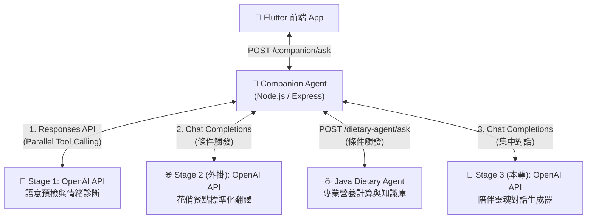
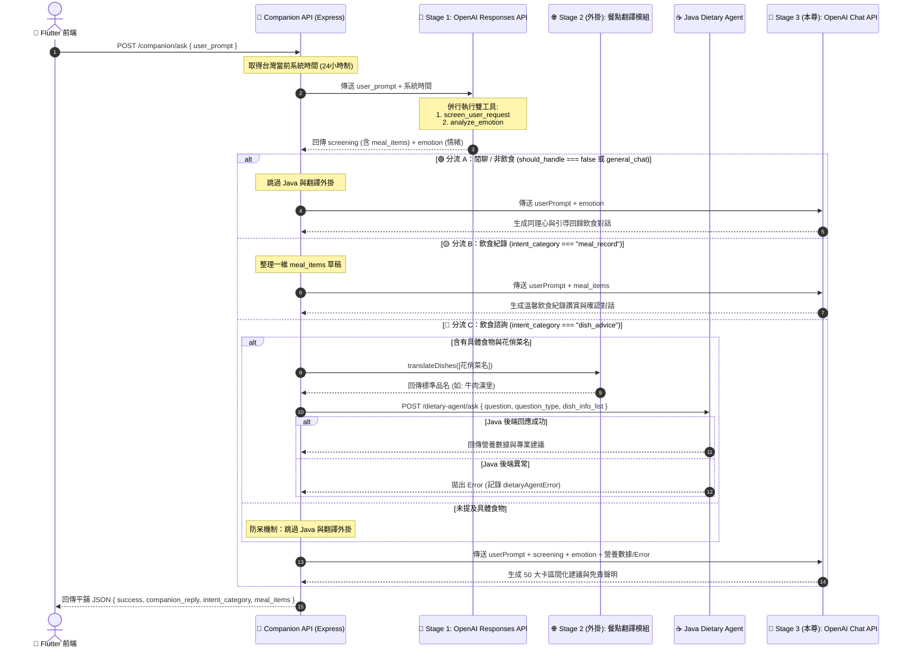

# Companion Agent 系統架構與對話流程全景說明書 (companion_structure_v1.md)

本文件整合並提煉 **Companion Agent（陪伴助理）** 之系統架構、元件關係、ASCII 與 Mermaid 流程圖、三路分流機制、三階段 API 對照表、傳輸合約與對話生命週期完整細節，為系統最終版架構說明文件。

---

## 📍 一、 系統架構定位與角色職責 (System Overview)

Companion Agent 在整體飲食推薦系統中，充當 **前端行動裝置 (Flutter App)** 與 **後端專業營養知識庫 (Java Dietary Agent)** 之間的 **「智慧對話與語意協調層」**。

* **對前 (Flutter Mobile App)**：接收使用者自然語言輸入，傳回溫馨、口語化且在地化的繁體中文陪伴對話與結構化飲食紀錄草稿 (`meal_items`)。
* **對後 (Java Dietary Agent)**：負責將使用者的模糊問句轉譯為結構化餐點資訊與數量，向 Java 營養資料庫發送精準查詢，並將嚴肅的專業營養數據轉化為易懂的關懷對話。

### 1. 微服務角色關聯圖 (Mermaid Architecture Diagram)



### 2. v6 核心架構 ASCII 流程圖 (Three-Way Routing Architecture Flowchart)

```text
+-----------------------------------------------------------------------------------+
|                                 使用者輸入 (user_prompt)                             |
+-----------------------------------------------------------------------------------+
                                          |
                                          v
+-----------------------------------------------------------------------------------+
|                        【第 1 次 API】runLLMAnalysis                              |
|   - 意圖分類 (screen_user_request):                                               |
|     should_handle, intent_category, question_type, confidence                     |
|   - 情緒診斷 (analyze_emotion):                                                   |
|     primary_emotion, psychological_context, companion_tone, evidence              |
|   - 食物/份數/單位/餐期一維陣列抽取 (meal_items)                                    |
|   * 特色：純冷靜結構化 JSON，無 Persona，不生成自然語言對話                           |
|   * 附註：dish_info_list 為 Node.js 後端收到 meal_items 後自動提煉之衍生字典        |
+-----------------------------------------------------------------------------------+
                                          |
                                          v
                                    三路分流判斷
                                          |
        +---------------------------------+---------------------------------+
        |                                 |                                 |
        v                                 v                                 v
  【分流 A：閒聊 / 非飲食】           【分流 B：飲食紀錄】              【分流 C：飲食諮詢】
  (should_handle === false)     (intent_category ===         (intent_category ===
   或 general_chat)                "meal_record")               "dish_advice")
        |                                 |                                 |
        |                                 v                                 |
        |                         [ 整理/按餐期歸類 ]                       |
        |                         [   meal_items   ]                        |
        |                                 |                                 |
        |                                 v                                 |
        |                      +-----------------------+                    |
        |                      |  前端草稿彈跳視窗      |                    |
        |                      |  (Flutter Popup UX)   |                    |
        |                      +-----------------------+                    |
        |                                 |                                 |
        |                                 |                                 v
        |                                 |                     是否包含具體食物資訊？
        |                                 |                       /            \
        |                                 |                     否              是
        |                                 |                     /                \
        |                                 |                    v                  v
        |                                 |           [ 跳過 Java 與翻譯 ]    【第 2 次 API】translateDishes
        |                                 |                    |             (條件觸發：花俏/行銷菜名標準化)
        |                                 |                    |                  |
        |                                 |                    |                  v
        |                                 |                    |         [ 呼叫 Java Dietary Agent ]
        |                                 |                    |         (POST /dietary-agent/ask)
        |                                 |                    |                  |
        |                                 |                    |                  v
        |                                 |                    |         dietaryAgentResponse
        |                                 |                    |       (熱量與營養數據分析結果)
        |                                 |                    |                  |
        +---------------------------------+--------------------+------------------+
                                          |
                                          v
+-----------------------------------------------------------------------------------+
|                        【第 3 次 API】runLLMReply                                 |
|   - 小精靈本尊對話生成器 (100% 集中注入完整 Persona 靈魂)                         |
|   - 整合情境：                                                                    |
|     1) 閒聊導回同理對話                                                           |
|     2) 飲食紀錄確認與溫馨讚賞                                                     |
|     3) 無食物時親切引導補充                                                       |
|     4) 結合 Java 營養數據生成 50 大卡區間化建議與免責聲明                          |
+-----------------------------------------------------------------------------------+
                                          |
                                          v
+-----------------------------------------------------------------------------------+
|                            最終對話文字 (companion_reply)                          |
+-----------------------------------------------------------------------------------+
```

---

## 📌 二、 三次 OpenAI API 呼叫之「順序、目的與產出」精確對照表

本系統在一次對話生命週期中，最多會呼叫 **3 次 OpenAI API**（部分分支可依路徑優化降至 1~2 次）：

| 執行順序 | 函數名稱 | 觸發條件 | 核心目的與職責 | 使用 API 與模式 | Input 輸入 | 核心 Output (產出物) |
| :---: | :--- | :--- | :--- | :--- | :--- | :--- |
| **第 1 次** | `runLLMAnalysis`<br/>(`runOpenAIFlow`) | 每次發問<br/>**必定執行** | **【冷靜 JSON 抽取與診斷器】**<br/>1. 判斷是否為飲食問題 (`should_handle`)<br/>2. 分類意圖 (`dish_advice`/`meal_record`/`general_chat`)<br/>3. 一維抽取食物、份數、單位與推算餐期 (`meal_items`)<br/>4. 診斷情緒與脈絡 (`analyze_emotion`)<br/>* 絕不安插 Persona 或生成對話 * | OpenAI Responses API<br/>(`/v1/responses`)<br/>Parallel Tool Calling | `user_prompt`<br/>+ 台灣 24h 系統時間 | 1. `screening` JSON (含 `meal_items`, `dish_info_list`)<br/>2. `emotion` JSON (含 `primary_emotion`, `psychological_context`, `companion_tone`, `evidence`) |
| **第 2 次** | `translateDishes` | **條件式執行**：<br/>飲食諮詢且含花俏餐點名 | **【華麗餐點標準化翻譯外掛】**<br/>將花俏商品名（如「起司瀑布超厚牛肉堡」）轉譯為資料庫標準名（如「牛肉漢堡」），提升 Java 命中率 | OpenAI Chat Completions<br/>(`/v1/chat/completions`) | 花俏餐點名稱陣列<br/>(如 `["起司瀑布牛肉堡"]`) | 翻譯後標準餐點字典<br/>`translatedDishInfoList`<br/>(如 `{"牛肉漢堡": 1}`) |
| **(轉接)** | *(Java Dietary Agent)* | **條件式執行**：<br/>`should_handle: true`<br/>且含具體食物 | **【專業熱量與營養計算】**<br/>(向 Java 後端發送 POST 請求，計算熱量與三大營養素) | HTTP POST 傳輸<br/>(非 OpenAI API) | `question`, `question_type`, `dish_info_list` | 專業營養與建議 JSON<br/>`dietaryAgentResponse` |
| **第 3 次** | `runLLMReply`<br/>(`generateCompanionReply`) | 幾乎每次發問<br/>*(由三路分流集中處理)* | **【小精靈本尊對話生成器】**<br/>100% 集中注入 Persona 靈魂！統一生成閒聊同理引導、紀錄確認讚賞與 50 大卡區間化營養建議 | OpenAI Chat Completions<br/>(`/v1/chat/completions`) | `userPrompt`<br/>+ `screening`<br/>+ `emotion`<br/>+ 簡化營養數據 | 最終給使用者的對話文字<br/>`companion_reply` (string) |

> ⚠️ **開發團隊與隊長防呆提醒 (Pitfalls & Key Notes)**：
> 1. **代碼命名 vs 實際執行順序差異**：在 `companion-llm.js` 模組註解中，翻譯模組有時被標註為「Stage 3」，但在實際執行脈絡上，**翻譯是第 2 個執行的 API 呼叫**（在 Call Java 之前執行）。隊長與維護者請以執行脈絡為準！
> 2. **角色設定 (Persona) 集中注入**：為了防止 JSON 分類混亂與說話風格不一致，**所有角色靈魂與對話 Prompt 100% 集中在第 3 次呼叫 (`runLLMReply` / `REPLY_SYSTEM_PROMPT`)**！請勿在第 1 次 API 添加 Persona 提示詞。
> 3. **核心字典 `dish_info_list` 的由來**：第 1 次 API 的原生 Output 僅為 `meal_items` 一維陣列。Node.js 後端在 `sanitizeScreening` 中走訪 `meal_items` 自動提煉出字典 `{ "炸雞": 2 }` 作為衍生欄位，專門用於後續發送給 Java 與翻譯外掛，此舉可節省 LLM Token 並確保 Single Source of Truth。
> 4. **微服務高容錯與降級**：若下游 Java Dietary Agent 斷線或回應 500，Companion Agent 會將錯誤捕捉為 `dietaryAgentError` 旗標，**不中斷對話**，由第 3 次 API 回傳關懷文字與降級回應。

---

## 🔄 三、 對話生命週期與三路分流機制 (Sequence Diagram & Routing)

### 1. 完整生命週期順序圖 (Mermaid Sequence Diagram)



### 2. 三路分流機制詳細說明 (Three-Way Routing Breakdown)

* **🟢 分流 A：閒聊 / 非飲食 (`should_handle === false` 或 `general_chat`)**
  * **處理路徑**：`runLLMAnalysis` $\to$ **跳過 Java 與翻譯外掛** $\to$ `runLLMReply`
  * **運作機制**：第 1 次預檢確定非飲食後，直接將 `userPrompt` 與 `emotion` 送入 `runLLMReply`。由小精靈提供極具同理心的回應，並溫柔引導使用者回歸飲食話題。
  * **效能優化**：省去 Java 呼叫與翻譯，僅耗費 2 次 API 呼叫。

* **🟡 分流 B：飲食紀錄 (`intent_category === "meal_record"`)**
  * **處理路徑**：`runLLMAnalysis` $\to$ 整理 `meal_items` $\to$ **極速回傳前端草稿彈跳視窗** (+ `runLLMReply` 讚賞語)
  * **運作機制**：第 1 次 API 完成時，一維陣列 `meal_items` 已精準抽出食物名稱、數量、單位與推算餐期（早餐/中餐/晚餐）。後端直接將 `meal_items` 回傳前端供 Flutter 彈出草稿視窗，同時由 `runLLMReply` 提供溫馨讚賞對話。
  * **效能優化**：完全免去 Call Java 與翻譯，極速回應！

* **🔵 分流 C：飲食諮詢 (`intent_category === "dish_advice"`)**
  * **處理路徑**：`runLLMAnalysis` $\to$ 檢查食物資訊 $\to$ (條件) `translateDishes` $\to$ `Java Dietary Agent` $\to$ `runLLMReply`
  * **運作機制**：
    * **有具體食物**：若含花俏菜名先微型翻譯，再 POST 給 Java 計算熱量與三大營養素，最後由 `runLLMReply` 將專業數值轉化為「50 大卡區間」及「免責聲明」之親切建議。
    * **防呆機制（無具體食物）**：若使用者問「我這樣吃會太胖嗎？」但未提及食物，系統**自動跳過 Java 後端與翻譯**，直奔 `runLLMReply` 由小精靈親切關懷並引導補充具體餐點。

---

## 🧩 四、 核心三階段運作細節 (Detailed Stage Breakdown)

### 階段一：併行語意預檢與情緒分析 (Stage 1: Intent & Emotion Screening)

* **採用技術**：OpenAI Responses API (`/v1/responses`) 搭配 **Parallel Tool Calling (平行工具調用)**。
* **輸入資訊**：使用者原始問句 + 台灣本地 24 小時制系統時間（例如：`當前系統時間: 2026-08-23 18:00`）。
* **併行呼叫之雙 Tool Schemas**：
  1. `screen_user_request` (意圖與一維餐點擷取)：
     * `should_handle` (boolean)：判定是否為飲食相關議題（非飲食閒聊或敏感醫療設為 `false`）。
     * `intent_category` (enum)：`dish_advice` (飲食諮詢), `meal_record` (飲食紀錄), `general_chat` (一般閒聊)。
     * `question_type` (enum)：`single_dish` (單一餐點), `dish_comparison` (餐點比較), `unknown` (未提及具體餐點), `not_applicable` (非飲食諮詢時填入)。
     * `confidence` (number)：意圖分類信心分數。
     * `meal_items` (array)：採用一維物件陣列 `[{ name, quantity, unit, meal_period }]`，依據系統時間或問句時間詞自動推算餐期（`早餐`、`中餐`、`晚餐`、`其他`）。
  2. `analyze_emotion` (情緒診斷與脈絡分析)：
     * `primary_emotion` (enum)：主情緒標籤 (`neutral`, `joy`, `anxiety`, `guilt`, `stress`, `frustration`, `fatigue`)。
     * `psychological_context` (enum)：情緒與情境脈絡分類 (`work_overtime_stress`, `diet_relapse_guilt`, `weather_or_mood`, `social_dining`, `routine_craving`, `other_general_chat`)。
     * `companion_tone` (enum)：建議陪伴語態 (`comforting`, `encouraging`, `playful`, `neutral`)。
     * `evidence` (array)：擷取自使用者原話的情感與脈絡關鍵字詞陣列（如 `["下雨", "鞋子濕"]`）。
* **資料提煉 (`sanitizeScreening`)**：
  * 從 `meal_items` 自動提煉內部字典 `dish_info_list: { "炸雞": 2, "拉麵": 1 }`。

---

### 中間轉接層：標準化翻譯與 Java 後端查詢 (Middle Layer)

1. **品名標準化翻譯 (Dish Translation)**：
   * 若意圖為 `dish_advice` 且包含餐點，呼叫 OpenAI 翻譯模組，將行銷花俏品名（如：「起司瀑布超厚牛肉堡」）轉譯為資料庫標準品名（如：「牛肉漢堡」），保留原始份數。
2. **發送至 Java Dietary Agent**：
   * 將 `dish_info_list` 轉型為 Java 後端 DTO 物件陣列 (`[ { "dish_name": "炸雞", "amount": 2 } ]`)。
   * 發送 POST 請求至 `/dietary-agent/ask`。若 Java 異常，轉為 `dietaryAgentError` 旗標，**不中斷對話**。

---

### 階段三：陪伴式對話生成與重組 (Stage 3: Companion Reply Generation)

* **採用技術**：OpenAI Chat Completions API (`/v1/chat/completions`)。
* **輸入 Context**：使用者問句、`screening`、`emotion`、簡化後 `dietaryAgentResponse`（或 `dietaryAgentError`）。
* **動態生成與重組規則 (`REPLY_SYSTEM_PROMPT`)**：
  * **【情境 A：飲食後端異常】**：誠實告知後端維護中，給予常識性日常飲食建議。
  * **【情境 B：閒聊/非飲食】**：展現同理心，婉轉說明精靈職責並軟性引導回到飲食範疇。
  * **【情境 C：飲食紀錄確認】**：給予讚賞並親切提示草稿卡片已為使用者整理好。
  * **【情境 D：未提及食物】**：親切關懷，引導使用者補充想詢問的具體餐點。
  * **【情境 E：正常諮詢建議】**：將專業數據口語化，遵循 **「熱量以 50 大卡為區間範圍」** 規則（如：380 大卡 $\to$ 「350～400 大卡」），並在末尾獨立加上免責聲明：*「關於數值類提問，本精靈只可提供參考數值」*。

---

## 📩 五、 API 傳輸合約範例 (API Payloads & Contracts)

### 1. 前端請求 Companion Agent API (`POST /companion/ask`)

* **Request Header**: `Authorization: Bearer <JWT_TOKEN>`
* **Request Body**:
  ```json
  {
    "user_prompt": "中午吃了 2 塊炸雞，晚上還可以吃 1 碗拉麵嗎？"
  }
  ```

### 2. Stage 1 Output (OpenAI 原生 Output 與 Node.js 提煉欄位)

```json
{
  "should_handle": true,
  "intent_category": "dish_advice",
  "question_type": "dish_comparison",
  "meal_items": [
    {
      "name": "炸雞",
      "quantity": 2,
      "unit": "塊",
      "meal_period": "中餐"
    },
    {
      "name": "拉麵",
      "quantity": 1,
      "unit": "碗",
      "meal_period": "晚餐"
    }
  ],
  "dish_info_list": {
    "炸雞": 2,
    "拉麵": 1
  }
}
```

### 3. Companion Agent 發送給 Java Dietary Agent (`POST /dietary-agent/ask`)

```json
{
  "question": "中午吃了 2 塊炸雞，晚上還可以吃 1 碗拉麵嗎？",
  "question_type": "dish_comparison",
  "dish_info_list": [
    {
      "dish_name": "炸雞",
      "amount": 2
    },
    {
      "dish_name": "拉麵",
      "amount": 1
    }
  ]
}
```

### 4. Companion Agent 回應給 Flutter 前端 (`POST /companion/ask` Response)

```json
{
  "success": true,
  "companion_reply": "今天晚餐想吃拉麵呀！考量到你中午吃了 2 塊炸雞（熱量大約在 550～600 大卡左右），晚上如果選拉麵建議可以選擇清湯湯底喔！\n關於數值類提問，本精靈只可提供參考數值",
  "intent_category": "dish_advice",
  "meal_items": [
    {
      "name": "炸雞",
      "quantity": 2,
      "unit": "塊",
      "meal_period": "中餐"
    },
    {
      "name": "拉麵",
      "quantity": 1,
      "unit": "碗",
      "meal_period": "晚餐"
    }
  ],
  "dietary_agent_error": null
}
```
> 💡 *相容性說明：前端 Service 層收下 `meal_items` 一維陣列後，可自動進行 Group By 組裝為 2D 巢狀 `meal_records`（`[{ meal_period, meal_items }]`），相容現有草稿彈窗視窗。*

---

## 🚀 六、 系統核心架構優勢總結 (System Architectural Strengths)

1. **單次併行語意解析 (Single-Pass Parallel Extraction)**：
   在 Stage 1 透過一次 Response API 呼叫同時完成「意圖分類」、「一維餐點提取」、「數量計算」、「餐期推算」與「情緒診斷」，避免多層次 LLM 連鎖呼叫帶來的昂貴網路延遲。

2. **一維合一物 Schema 最佳實踐 (High Cohesion & Zero Misalignment)**：
   採用一維物件陣列 `meal_items` (`name`, `quantity`, `unit`, `meal_period`)，解決過去兩層巢狀結構導致 LLM 注意力分散與索引錯位的隱患，抽樣精準度達到最高。

3. **極致的 Flutter 草稿視窗體驗 (Instant Popup UX)**：
   `meal_items` 於第 1 次 API 瞬間完成抽取，後端能立即提供結構化 JSON 給前端彈窗，飲食紀錄流程無須等待 Java 後端計算。

4. **第 1 次 API 100% 高穩定度 (Pure Cold JSON / No Persona)**：
   移除 Stage 1 中的 Persona 與對話生成 (`early_reply`)，使 `runLLMAnalysis` 成為純粹冷靜的 JSON 解析器，大幅降低 `JSON.parse` 失敗率。

5. **小精靈角色口吻 100% 統一 (Single Point of Persona)**：
   對話產出 100% 集中在第 3 次 API (`runLLMReply`)，維護單一 Prompt 即可保持完全一致的角色口吻與風格。

6. **高容錯微服務降級機制 (Graceful Degradation)**：
   即便下游 Java Dietary Agent 斷線或報錯，Companion Agent 依然能透過 Stage 3 進行降級應答，誠實告知使用者並提供通用飲食關懷，確保 App 不會遭遇 500 崩潰。

7. **精準餐點數量控制 (Quantity & Dict Structure)**：
   維護 `dish_info_list: { "餐點": 份數 }` 字典結構，精準傳遞「吃了 2 塊炸雞」之份數資訊給 Java 知識庫。

8. **時間維度自動推算 (24-Hour Time Context)**：
   自動帶入 24 小時制台灣系統時間，使問句中未明寫「早餐/晚餐」的提問能精準自動歸類到對應餐期。

9. **Token 瘦身與隱私保護 (Payload Slimming)**：
   將傳給 Stage 3 與前端的 Context 進行解包與平鋪，過濾掉不必要的內部偵錯數據，有效降低網路傳輸耗時與 OpenAI API 計費成本。

---
*文件更新時間：2026-08-23 18:06 (已完成 companion_agent_structure.md 與 companion_agent_structure_v2.md 之全景內容聯集與最新 Version 6 架構整合)*
