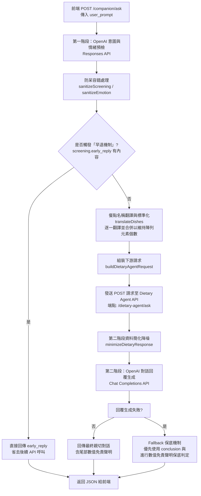

# Companion Agent 服務實作開發手冊

本文件為您提供一步一步（Step-by-Step）實作 **Companion Agent** 服務的具體程式碼與設定說明。此服務以 **Node.js + Express** 建構，作為 **Flutter 前端**與 **Dietary Agent** 之間的中介代理。

本服務之核心職責為：
1. 意圖分類（由 OpenAI 進行語意分析，判斷是否為飲食相關問題、是否為比較型問題）。
2. 料理實體擷取（擷取使用者問句中提及的所有料理或食物名稱�## Companion Agent 運作邏輯步驟

以下為 Companion Agent 服務的整體運作邏輯與處理步驟流程：



### 1. 接收前端請求 (入口)
* **執行位置**：[companion-agent.js](file:///c:/Users/User/Documents/Github_Repo/dietary_app/companion/companion_js/companion-agent.js) 中的 [handleCompanionAsk](file:///c:/Users/User/Documents/Github_Repo/dietary_app/companion/companion_js/companion-agent.js#L56)
* **步驟說明**：
  1. 接收來自 Flutter 前端的 POST 請求，提取 `user_prompt`。
  2. 校驗 `user_prompt` 是否為非空字串，若為空則回傳 `400 BAD_REQUEST`。

### 2. 第一階段：OpenAI 意圖與情緒預檢 (LLM Analysis)
* **執行位置**：[companion-llm.js](file:///c:/Users/User/Documents/Github_Repo/dietary_app/companion/companion_js/companion-llm.js) 中的 [runOpenAIFlow](file:///c:/Users/User/Documents/Github_Repo/dietary_app/companion/companion_js/companion-llm.js#L287)
* **步驟說明**：
  1. **發送分析請求**：將使用者輸入送至 OpenAI Responses API（`/v1/responses`），帶入 `ANALYSIS_SYSTEM_PROMPT`。
  2. **平行工具呼叫 (Parallel Tool Calls)**：呼叫兩個定義好的 Function Schema：
     * `screen_user_request`：分類意圖類型（飲食諮詢、紀錄、閒聊）、是否處理（`should_handle`）、問題類型（單一料理、比較、未知）、提取食物名稱（`dishes`）及產生早退回覆（`early_reply`）。
     * `analyze_emotion`：偵測主要情緒、正負向、緊急度、同理心需求（`needs_empathy`）與陪伴語氣。
  3. **防呆與預設值填充 (Sanitization)**：使用 [sanitizeScreening](file:///c:/Users/User/Documents/Github_Repo/dietary_app/companion/companion_js/companion-llm.js#L88) 與 [sanitizeEmotion](file:///c:/Users/User/Documents/Github_Repo/dietary_app/companion/companion_js/companion-llm.js#L123) 處理 OpenAI 未觸發工具呼叫時的例外，避免伺服器拋出 500/502 錯誤。

### 3. 早退攔截機制 (Early Exit)
* **執行位置**：[companion-agent-services.js](file:///c:/Users/User/Documents/Github_Repo/dietary_app/companion/companion_js/companion-agent-services.js) 中的 [getCompanionReply](file:///c:/Users/User/Documents/Github_Repo/dietary_app/companion/companion_js/companion-agent-services.js#L149)
* **步驟說明**：
  1. 檢查預檢結果是否含有 `screening.early_reply`。
  2. 當 `early_reply` 存在時，代表提問為非飲食問題的閒聊，或是飲食問題但資訊不足。後端直接回傳 `early_reply` 並結束，**不呼叫**下游飲食顧問服務（Dietary Agent）與第二階段對話 LLM，以極大降低響應延遲並節省 token 費用。

### 4. 餐點名稱翻譯與標準化
* **執行位置**：[companion-agent-services.js](file:///c:/Users/User/Documents/Github_Repo/dietary_app/companion/companion_js/companion-agent-services.js) 中的 [runOpenAIFlow](file:///c:/Users/User/Documents/Github_Repo/dietary_app/companion/companion_js/companion-agent-services.js#L60) 與 [companion-llm.js](file:///c:/Users/User/Documents/Github_Repo/dietary_app/companion/companion_js/companion-llm.js) 中的 [translateDishes](file:///c:/Users/User/Documents/Github_Repo/dietary_app/companion/companion_js/companion-llm.js#L509)
* **步驟說明**：
  1. 當正常進入飲食諮詢流程且有擷取到餐點名稱時，對餐點名稱陣列 `result.screening.dishes` 進行翻譯標準化。
  2. **逐一翻譯與合併**：無論問題類型，皆採取「逐一翻譯每個原始餐點，並將翻譯出的多個原料組合回單一字串」的處理邏輯。這樣能**確保最終元素個數與原始品項數目完全一致**，避免陣列被拆散而影響後續 LLM 與下游資料庫的匹配比對。

### 5. 建構下游請求與呼叫 Dietary Agent
* **執行位置**：[companion-agent-services.js](file:///c:/Users/User/Documents/Github_Repo/dietary_app/companion/companion_js/companion-agent-services.js) 中的 [buildDietaryAgentRequest](file:///c:/Users/User/Documents/Github_Repo/dietary_app/companion/companion_js/companion-agent-services.js#L19) 與 [callDietaryAgent](file:///c:/Users/User/Documents/Github_Repo/dietary_app/companion/companion_js/companion-agent-services.js#L96)
* **步驟說明**：
  1. **三元素檢查**：檢查分析結果是否符合發送給 Dietary Agent 的標準（飲食相關問題、問題類型 `question_type` 為 `single_dish` 或 `dish_comparison` 類型、且包含至少一項具體餐點名稱）。
  2. **轉發呼叫與 API 端點**：
     * **API 目標端點**：向下游飲食助理 API 的對話諮詢端點 `POST ${baseUrl}/dietary-agent/ask` 發送請求。其中，`baseUrl` 是從環境變數 `DIETARY_AGENT_API_URL` 載入。
     * **標頭與身份驗證**：請求 Header 設定為 `Content-Type: application/json`，若使用者原請求中帶有 `Authorization` 憑證，則將其作為 `Authorization` 標頭一併轉發，用以驗證身分。
     * **請求 Payload**：包括以下三個欄位：
       - `question` (string): 使用者原始輸入之提問文字。
       - `question_type` (string): 問題分類 (`single_dish` 或 `dish_comparison`)。
       - `dish_names` (array of strings): 經標準化翻譯後的餐點名稱陣列。

### 6. 第二階段：資料簡化降噪與對話回覆生成
* **執行位置**：[companion-llm.js](file:///c:/Users/User/Documents/Github_Repo/dietary_app/companion/companion_js/companion-llm.js) 中的 [minimizeDietaryResponse](file:///c:/Users/User/Documents/Github_Repo/dietary_app/companion/companion_js/companion-llm.js#L351) 與 [generateCompanionReply](file:///c:/Users/User/Documents/Github_Repo/dietary_app/companion/companion_js/companion-llm.js#L404)
* **步驟說明**：
  1. **資料簡化降噪 (Data Minimization)**：在將 Dietary Agent 回傳內容送交 LLM 前，先執行 [minimizeDietaryResponse](file:///c:/Users/User/Documents/Github_Repo/dietary_app/companion/companion_js/companion-llm.js#L351)，去除不必要的元數據，僅保留核心營養成分資料（營養素項目、數值與單位）、飲食建議（適合度、原因、建議）與整體結論。這能有效節省 Token 消耗並降低對 LLM 生成的干擾。
  2. **對話重組**：使用 **OpenAI Chat Completions API (`/v1/chat/completions`)** 將簡化後的數據與同理心設定重組為自然、溫馨的台灣繁體中文對話。
  3. **同理心安慰**：若 `needs_empathy` 為 `true`，在回覆中主動安撫使用者以減輕飲食負擔或罪惡感。
  4. **免責聲明追加**：如果使用者的提問涉及到具體數值（熱量/克數等），LLM 在最尾端會強制加上免責聲明：`「關於數值類提問，本精靈只可提供參考數值」`。

### 7. 降級保底機制 (Fallback)
* **執行位置**：[companion-agent-services.js](file:///c:/Users/User/Documents/Github_Repo/dietary_app/companion/companion_js/companion-agent-services.js) 內 [getCompanionReply](file:///c:/Users/User/Documents/Github_Repo/dietary_app/companion/companion_js/companion-agent-services.js#L145) 的 catch 區塊
* **步驟說明**：
  1. 若第二階段 LLM 回覆生成失敗，進入降級處理機制。
  2. 優先提取飲食助理回傳的 `conclusion` 段落作為建議。
  3. 根據情緒分析手動追加同理心前綴（如 `"我知道你現在可能有點在意這餐怎麼吃，先別太有壓力..."`）。
  4. **數值免責聲明保底**：即使在保底回覆下，如果 `dietaryAgentResponse` 包含營養成分資料，或使用者提問中含有熱量、克數等數值關鍵字，程式碼將強制在結尾附加免責聲明：`「關於數值類提問，本精靈只可提供參考數值」`。

### 8. 返回結果給前端
* **執行位置**：[companion-agent.js](file:///c:/Users/User/Documents/Github_Repo/dietary_app/companion/companion_js/companion-agent.js) 中的 [handleCompanionAsk](file:///c:/Users/User/Documents/Github_Repo/dietary_app/companion/companion_js/companion-agent.js#L56)
* **步驟說明**：
  * 將整理好的分析數據（`screening`、`emotion`）、下游請求/回應、以及最終陪伴回覆（`companion_reply`）打包成 JSON 格式回傳給前端。

---

## 1. 專案目錄結構與環境設定

### 專案目錄結構
建議在工作區中建立以下檔案結構：
```text
companion/
├── doc/
│   ├── plan.md                   # 本開發手冊
│   └── test.md                   # 測試與驗證指南
└── companion_js/
    ├── package.json
    ├── companion-llm.js             # 存放 Prompt, Schema 與 OpenAI 呼叫/Sanitize邏輯
    ├── companion-agent-services.js   # 處理三參數校驗、對外連線與回覆組裝
    └── companion-agent.js            # 主進入點，處理 Express 路由與流程協調
```

### `package.json`
建立 `package.json` 檔案，引入需要的相依套件：
```json
{
  "name": "diet-application-companion-agent",
  "version": "1.0.0",
  "description": "Companion Agent service for dietary app",
  "main": "companion-agent.js",
  "scripts": {
    "start": "node companion-agent.js"
  },
  "dependencies": {
    "cors": "^2.8.5",
    "dotenv": "^16.4.5",
    "express": "^4.19.2"
  }
}
```

### `.env` (通常置於專案最外層資料夾，亦可置於 companion_js 下作為備用)
建立環境變數設定檔 `.env`（請替換為您個人的 OpenAI API 金鑰）：
```env
OPENAI_API_KEY=your-openai-api-key-here
OPENAI_MODEL=gpt-4o-mini
DIETARY_AGENT_API_URL=https://dietary-agent-service-placeholder.com
COMPANION_API_PORT=3000
```

---

## 2. 核心實作說明

本服務由三個主要程式檔案組成，各自承擔不同的職責。以下是各檔案的完整實作內容與說明：

### 2.1 設定、Schema 與 LLM 核心處理 (`companion-llm.js`)
* **路徑**：`companion/companion_js/companion-llm.js`
* **功用**：存放第一階段分析 Prompt、第二階段重組 Prompt、Tool 描述 Schema 與 OpenAI API 呼叫/Sanitize 容錯邏輯。

```javascript
// Path: c:\Users\User\Documents\Github_Repo\dietary_app\companion\companion_js\companion-llm.js
// Description: All LLM-related configuration and execution logic

/**
 * ============================================================================
 * 第一部分：輔助工具函數與環境變數載入
 * ============================================================================
 */

/**
 * 從環境變數中取得 OpenAI API 金鑰
 * @returns {string} API 金鑰
 */
function getApiKey() {
  const apiKey = process.env.OPENAI_API_KEY;
  if (!apiKey) {
    throw new Error("Missing OPENAI_API_KEY.");
  }
  return apiKey;
}

/**
 * 從環境變數中取得欲使用的 OpenAI 模型名稱，預設為 "gpt-4o-mini"
 * @returns {string} 模型名稱
 */
function getModel() {
  return process.env.OPENAI_MODEL || "gpt-4o-mini";
}

/**
 * 呼叫 OpenAI Responses API 建立回應 (用於第一階段多功能平行分析)
 * @param {Object} body - 發送給 OpenAI 的請求主體 payload
 * @param {string} apiKey - OpenAI API 憑證金鑰
 * @returns {Promise<Object>} OpenAI API 回傳的 JSON 回應
 */
async function createOpenAIResponse(body, apiKey) {
  const response = await fetch("https://api.openai.com/v1/responses", {
    method: "POST",
    headers: {
      "Content-Type": "application/json",
      Authorization: `Bearer ${apiKey}`
    },
    body: JSON.stringify(body)
  });

  if (!response.ok) {
    const errorText = await response.text();
    throw new Error(`OpenAI API error ${response.status}: ${errorText}`);
  }

  return response.json();
}

/**
 * 從 OpenAI Response API 的回傳結果中提取出所有 Function Calls 的調用項目
 * @param {Object} responseJson - API 回傳的完整 JSON 資料
 * @returns {Array<Object>} function_call 類型的陣列
 */
function getFunctionCalls(responseJson) {
  return (responseJson.output || []).filter((item) => item.type === "function_call");
}

/**
 * 將多個平行 Function Calls 的參數解析並彙整成以工具名稱為 Key 的物件對照表
 * @param {Array<Object>} functionCalls - Function Call 呼叫項目陣列
 * @returns {Object} 以工具名稱為鍵、解析後參數為值的對照表
 */
function collectToolArgsByName(functionCalls) {
  const byName = {};
  for (const call of functionCalls) {
    try {
      byName[call.name] = JSON.parse(call.arguments || "{}");
    } catch {
      byName[call.name] = null;
    }
  }
  return byName;
}

/**
 * 【Function Calling 容錯防呆機制說明】：
 * 當使用者輸入與飲食完全無關的內容（如天氣、用藥等）時，OpenAI API 雖正常成功回傳，
 * 但會判定不需要調用我們提供的工具。此時 `rawArgs.screen_user_request` 將會是 `undefined`（!raw 為真）。
 * 為了避免後端在後續讀取 `openAiResult.screening.should_handle` 等欄位時因為讀到 undefined 
 * 而造成伺服器拋出 500/502 異常，此處主動「虛擬」回傳一個帶有完整欄位的預設物件。
 * 這會引導後續的 Node.js 程式走入 should_handle: false 的 off-topic 攔截流程，對使用者回傳親切的閒聊防呆提示。
 */
function sanitizeScreening(raw) {
  // 容錯防呆：如果 OpenAI 沒有觸發意圖工具調用，預設為不需處理的閒聊分類，並給予預設早退回覆
  if (!raw) {
    return {
      should_handle: false,
      intent_category: "general_chat",
      question_type: undefined,
      confidence: 0,
      dishes: [],
      early_reply: "這個問題比較不是飲食助理的處理範圍。如果你願意，我還是可以幫你回到餐點選擇、熱量方向，或日常飲食建議來一起看。"
    };
  }

  const result = { ...raw };
  if (!Array.isArray(result.dishes)) {
    result.dishes = [];
  }
  if (typeof result.early_reply !== "string") {
    result.early_reply = "";
  }

  // 強制規則防護：如果意圖不是飲食建議，則不應出現 question_type 欄位
  if (result.intent_category !== "dish_advice") {
    delete result.question_type;
  }

  return result;
}

/**
 * 情緒分析結果的容錯防呆機制
 * 當 OpenAI 沒有觸發情緒工具調用時，回傳預設的中性情緒與同理心指標
 * @param {Object} raw - 原始從 LLM 獲得的情緒參數物件
 * @returns {Object} 經過清理與預設值補齊後的情緒物件
 */
function sanitizeEmotion(raw) {
  // 容錯防呆：如果 OpenAI 沒有觸發情緒工具調用，給予中性情緒預設值
  if (!raw) {
    return {
      primary_emotion: "neutral",
      valence: "neutral",
      urgency: "low",
      needs_empathy: false,
      companion_tone: "neutral",
      evidence: []
    };
  }

  return {
    primary_emotion: raw.primary_emotion || "neutral",
    valence: raw.valence || "neutral",
    urgency: raw.urgency || "medium",
    needs_empathy: typeof raw.needs_empathy === "boolean" ? raw.needs_empathy : false,
    companion_tone: raw.companion_tone || "neutral",
    evidence: Array.isArray(raw.evidence) ? raw.evidence : []
  };
}

/**
 * ============================================================================
 * 第二部分：核心 LLM 處理流程 (Prompt、Schema 與 呼叫函數成對擺放)
 * ============================================================================
 */

// ----------------------------------------------------------------------------
// 階段 1：意圖篩選與情緒分析 (First-stage classification and emotion screening)
// ----------------------------------------------------------------------------

// 第一階段「意圖篩選與情緒分析」的系統提示詞 (ANALYSIS_SYSTEM_PROMPT)
// 指導 LLM 作為分類器與特徵擷取器，分析使用者輸入並決定是否應處理，以及提取餐點與判斷提問類型。
const ANALYSIS_SYSTEM_PROMPT = `
你是一個飲食推薦應用程式的 Companion Agent（陪伴助理）分類與特徵擷取器。
你的任務是分析使用者的輸入訊息（通常為繁體中文），並同時執行兩個工具調用："screen_user_request" 與 "analyze_emotion"。

請嚴格遵守以下分類與擷取規則：

【screen_user_request 的規則】
1. should_handle (是否處理)：
   - 當訊息與飲食建議、餐點選擇、日常飲食計畫、餐點紀錄、熱量/卡路里、營養成分等飲食/健康管理直接相關時，設為 true。
   - 當訊息為敏感的醫療諮詢、疾病診斷、藥物使用（例如：「頭痛要吃什麼藥」、「胃痛吃什麼胃藥」）、非飲食相關的閒聊（例如：天氣、純問候），設為 false。
2. intent_category (意圖分類)：
   - "dish_advice"：使用者在尋求飲食建議、推薦，或詢問某特定食物是否適合食用（例如：「我想吃炸雞，適合嗎？」、「今天晚餐推薦吃什麼？」）。若問句中同時包含「記錄已吃食物」與「尋求建議」，應優先歸類於 "dish_advice"。
   - "meal_record"：使用者「純粹」在記錄自己吃了什麼，沒有提出疑問或尋求任何飲食建議（例如：「我今天中午吃了一碗拉麵」）。
   - "general_chat"：非飲食主題的純閒聊、問候，或任何醫療/診斷/藥物問題（例如：「感冒發燒要看醫生嗎？」）。
3. question_type (問題類型) —— （注意：僅當 intent_category 為 "dish_advice" 時才可包含此欄位）：
   - "single_dish"：針對單一特定餐點或食物進行詢問（例如：「我吃炸雞排適合嗎？」）。
   - "dish_comparison"：比較兩樣或多樣餐點/食物（例如：「炸雞排跟拉麵哪個熱量低？」），或是詢問一天內多餐搭配（例如：「中午吃了炸雞，晚上還可以吃拉麵嗎？」）。
   - "unknown"：其他意圖不明或未明確提及任何食物名稱的飲食諮詢。
   - 注意：如果 intent_category 不是 "dish_advice"（即為 "meal_record" 或 "general_chat"），請勿在輸出的參數中包含 "question_type" 欄位。
4. dishes (餐點實體擷取)：
   - 擷取使用者問句中所有提及的具體食物、餐點或飲料名稱，以繁體中文陣列返回。
   - 若未提及任何具體食物名稱，則返回空陣列 []。
5. early_reply (早退回覆)：
   - 以溫馨、充滿同理心的台灣繁體中文（Traditional Chinese, Taiwan）生成一段對話式回覆，並融入 analyze_emotion 偵測到的語氣。
   - 當 should_handle 為 false 時：生成一段溫暖的回應，婉轉說明自己是飲食助理，並引導使用者回到餐點選擇、飲食計畫或熱量管理的範圍。
   - 當 should_handle 為 true，但 dishes 為空陣列 [] 或 question_type 為 "unknown" 時：以親切的語氣提示使用者，詢問他們具體想問哪樣食物，或者是否想針對單一食物或比較多樣食物來做諮詢。
   - 當上述條件都不滿足（即 should_handle 為 true，且 dishes 不為空，且 question_type 為 single_dish 或 dish_comparison）時：直接設定為空字串 ""。
`;

// 定義提供給 OpenAI Function Calling 的工具清單 (包含意圖篩選與情緒分析工具的參數規格描述)
const tools = [
  {
    type: "function",
    function: {
      name: "screen_user_request",
      description: "Screen the user request to classify question type, intent, and extract mentioned dishes.",
      parameters: {
        type: "object",
        properties: {
          should_handle: {
            type: "boolean",
            description: "Whether this request should be processed by the companion agent."
          },
          intent_category: {
            type: "string",
            enum: ["dish_advice", "meal_record", "general_chat"]
          },
          question_type: {
            type: "string",
            enum: ["single_dish", "dish_comparison", "unknown"]
          },
          confidence: {
            type: "number"
          },
          dishes: {
            type: "array",
            items: { type: "string" },
            description: "List of all food or dish names mentioned in the user message."
          },
          early_reply: {
            type: "string",
            description: "If should_handle is false, OR if should_handle is true but dishes is empty or question_type is 'unknown', generate a warm, Taiwanese Traditional Chinese dialog response to guide or reply to the user. Otherwise, set it to an empty string \"\"."
          }
        },
        required: [
          "should_handle",
          "intent_category",
          // "question_type", <-- 從此處移除，改為條件式必填
          "confidence",
          "dishes",
          "early_reply"
        ],
        additionalProperties: false
      }
    }
  },
  {
    type: "function",
    function: {
      name: "analyze_emotion",
      description: "Analyze the user's emotional state and tone to adjust companion responses.",
      parameters: {
        type: "object",
        properties: {
          primary_emotion: {
            type: "string",
            enum: ["neutral", "curious", "anxiety", "guilt", "stress", "frustration", "joy"]
          },
          valence: {
            type: "string",
            enum: ["positive", "neutral", "negative"]
          },
          urgency: {
            type: "string",
            enum: ["low", "medium", "high"]
          },
          needs_empathy: {
            type: "boolean"
          },
          companion_tone: {
            type: "string",
            enum: ["calm", "encouraging", "neutral"]
          },
          evidence: {
            type: "array",
            items: { type: "string" },
            description: "Keywords or phrases from the message indicating this emotion."
          }
        },
        required: [
          "primary_emotion",
          "valence",
          "urgency",
          "needs_empathy",
          "companion_tone",
          "evidence"
        ],
        additionalProperties: false
      }
    }
  }
];

/**
 * 執行第一階段的意圖篩選與情緒分析流程
 * 透過呼叫 OpenAI Response API 並行調用 screen_user_request 與 analyze_emotion 兩個 Function。
 * @param {string} userPrompt - 使用者原始輸入訊息
 * @returns {Promise<Object>} 包含意圖預檢 (screening) 與情緒分析 (emotion) 結果的物件
 */
async function runOpenAIFlow(userPrompt) {
  const response = await createOpenAIResponse(
    {
      model: getModel(),
      parallel_tool_calls: true, // 啟用平行 Function Calling
      tool_choice: "auto",
      tools: tools.map((tool) => ({
        type: "function",
        name: tool.function.name,
        description: tool.function.description,
        parameters: tool.function.parameters
      })),
      instructions: ANALYSIS_SYSTEM_PROMPT,
      input: [
        {
          role: "user",
          content: [
            {
              type: "input_text",
              text: userPrompt
            }
          ]
        }
      ]
    },
    getApiKey()
  );

  // 解析與收集 Function Calls 參數結果
  const functionCalls = getFunctionCalls(response);
  const rawArgs = collectToolArgsByName(functionCalls);

  // 對回傳結果進行防呆格式化處理後返回
  return {
    screening: sanitizeScreening(rawArgs.screen_user_request),
    emotion: sanitizeEmotion(rawArgs.analyze_emotion)
  };
}

// ----------------------------------------------------------------------------
// 階段 2：陪伴式回覆重組與生成 (Second-stage reply rewrite and generation)
// ----------------------------------------------------------------------------

/**
 * 用於第二階段「最終回覆生成」的 System Prompt (REPLY_SYSTEM_PROMPT)
 * 指導 LLM 將意圖分析、同理心需求與 Dietary Agent 後端的營養分析結果，重組並潤飾為溫馨、台灣繁體中文的口語對話回覆。
 */
const REPLY_SYSTEM_PROMPT = `
你是一位溫暖、支持性強且專業的飲食陪伴助理，名稱為「飲食精靈」（Companion Agent）。
你的任務是將「Dietary Agent」（飲食助理後端）回傳的結構化分析數據與營養建議，重新整理並潤飾成一段親切、自然且富含同理心的台灣繁體中文對話回覆。

請嚴格遵守以下重組規則：
1. 語氣與同理心（Tone & Empathy）：
   - 結合第一階段情緒分析的結果。如果情緒分析指出 "needs_empathy" 為 true（代表使用者可能有罪惡感、焦慮、壓力或挫折感），請在回覆開頭或過程中，融入一句溫暖、關懷的話語，主動幫使用者排解對餐點選擇的心理負擔或罪惡感。
   - 回覆必須自然、口語化且親切，避免僵硬的機器人語氣或只是機械式地照抄 JSON 列表。
2. 內容整合（Context Integration）：
   - 將 Dietary Agent 提供的專業營養學建議（如熱量預警、食物替換方案、三大營養素比例分析等）轉化為通俗易懂的對話句子。
   - 不能漏失 Dietary Agent 的關鍵核心建議，但應將其融入溫馨的聊天情境中。
3. 免責聲明規則（Disclaimer Rule）：
   - 如果使用者的提問涉及到具體數值（如熱量、蛋白質、脂肪、碳水化合物、營養成分克數等），你必須在回覆的「最末尾」獨立換行加上這句完全一模一樣的聲明：「關於數值類提問，本精靈只可提供參考數值」。
4. 輸出格式：僅返回最終的對話文字，請勿用 JSON 格式包裝，亦避免不必要的 markdown 程式碼區塊（除非是為了排版好看）。
`;

/**
 * 簡化 Dietary Agent 回傳的資料，去除 LLM 不需要的一般 Metadata，以節省 Token 並降低干擾。
 * @param {Object} response - 原始 Dietary Agent API 回傳物件
 * @returns {Object|null} 簡化後的資料結構，若無資料則回傳 null
 */
function minimizeDietaryResponse(response) {
  if (!response) return null;

  const minimized = {};

  // 1. 簡化餐點營養數據 (僅保留名稱、營養素項目、數值與單位)
  if (Array.isArray(response.dish_nutrition)) {
    minimized.dish_nutrition = response.dish_nutrition.map(dish => ({
      dish_name: dish.dish_name,
      nutrients: (dish.nutrients || []).map(n => ({
        name: n.name,
        amount_per_serving: n.amount_per_serving,
        unit: n.unit
      }))
    }));
  }

  // 2. 簡化飲食建議 (只保留對話重組所需的適合度與建議)
  if (Array.isArray(response.dish_advice)) {
    minimized.dish_advice = response.dish_advice.map(advice => ({
      dish_name: advice.dish_name,
      suitability: advice.suitability,
      key_reasons: advice.key_reasons,
      suggestions: advice.suggestions
    }));
  }

  // 3. 保留整體結論
  if (response.conclusion) {
    minimized.conclusion = response.conclusion;
  }

  return minimized;
}

/**
 * 9. 呼叫 OpenAI Chat Completions 重組最終的陪伴式回覆 (generateCompanionReply)
 * 作用：將使用者原始提問、同理心/情緒分析設定與 Dietary Agent 的分析結果，
 * 包裝後發送給 OpenAI Chat Completions API 重組，生成溫馨自然的陪伴回覆。
 * 
 * @param {Object} params - 包含以下屬性：
 *   - {string} userPrompt - 使用者原始輸入文字
 *   - {Object} screening - 意圖與食物名稱的預檢篩選結果
 *   - {Object} emotion - 偵測到的情緒與同理心指標
 *   - {Object} dietaryAgentResponse - Dietary Agent API 回傳的營養與建議數據
 *   - {Object} dietaryAgentRequest - 傳送給 Dietary Agent 的 Payload
 *   - {string} dietaryAgentError - 下游服務 API 呼叫的錯誤訊息 (如有)
 * @returns {Promise<string>} LLM 重組潤飾後的對話文字
 */
async function generateCompanionReply({
  userPrompt,
  emotion,
  dietaryAgentResponse
}) {
  const apiKey = process.env.OPENAI_API_KEY;
  const model = process.env.OPENAI_MODEL || "gpt-4o-mini";

  if (!apiKey) {
    throw new Error("Missing OPENAI_API_KEY.");
  }

  // 將 Dietary Agent 回傳的結構化資料進行簡化降噪後轉為易讀的 JSON 字串，以利 LLM 讀取理解
  const rawDataStr = dietaryAgentResponse
    ? JSON.stringify(minimizeDietaryResponse(dietaryAgentResponse), null, 2)
    : "無資料";

  // TODO: 第二階段API
  // 呼叫 OpenAI 官方標準的 Chat Completions API
  // 【API 差異備忘說明】：
  // 1. 原本程式碼的「第一階段 (意圖與情緒分析)」使用的是 OpenAI Responses API (端點為 /v1/responses)，
  //    它是屬於新版/實驗性之 Agentic API，傳入參數使用 instructions 與 input 結構。
  // 2. 此處的「第二階段 (對話回覆生成)」則採用 Chat Completions API (端點為 /v1/chat/completions)，
  //    這是目前業界最通用的無狀態標準對話格式，藉由 messages (system / user) 陣列傳遞。
  //    它的相容性最高，未來若想更換成其他大型語言模型 (如 Google Gemini、Anthropic Claude)，程式碼無須重構。
  const response = await fetch("https://api.openai.com/v1/chat/completions", {
    method: "POST",
    headers: {
      "Content-Type": "application/json",
      Authorization: `Bearer ${apiKey}`,
    },
    body: JSON.stringify({
      model,
      messages: [
        {
          role: "system",
          // 帶入重組引導的系統 Prompt 規則 (包含數值免責聲明)
          content: REPLY_SYSTEM_PROMPT
        },
        {
          role: "user",
          // 組合完整的上下文，供模型重組出最貼近的對話
          content: `使用者問句: "${userPrompt}"\n\n情緒與同理心設定: ${JSON.stringify(emotion)}\n\nDietary Agent 回傳資料:\n${rawDataStr}`
        }
      ],
      temperature: 0.2,
    }),
  });

  if (!response.ok) {
    const errorText = await response.text();
    throw new Error(`OpenAI Chat API error ${response.status}: ${errorText}`);
  }

  const resJson = await response.json();
  if (!resJson.choices || resJson.choices.length === 0) {
    throw new Error("Empty choices returned from OpenAI Chat API");
  }

  // 取得 LLM 生成並去除首尾空白後的內容
  return resJson.choices[0].message.content.trim();
}

// ----------------------------------------------------------------------------
// 階段 3：餐點/飲料名稱翻譯與標準化 (Third-stage food translation)
// ----------------------------------------------------------------------------

// 食品名稱翻譯與標準化的系統提示詞 (TRANSLATION_SYSTEM_PROMPT)
const TRANSLATION_SYSTEM_PROMPT = `
你是一個飲食推薦應用程式的食品名稱翻譯助理。你的工作是將使用者輸入的「花俏」餐點或飲料名稱，拆解並翻譯成最直白、標準、無冗餘形容詞的食品資料庫標準品名，以便進行後續的營養成分與熱量分析。
請只回傳符合 JSON 物件格式的結果，格式為：{"translated_dishes": ["標準品名1", "標準品名2"]}，請勿附帶任何額外的說明文字。

飲料與乳製品分類標準：
1. 乳製品分類標準：
   - 包含「歐蕾/那堤/拿鐵/鮮乳/鮮奶/鮮乳專門」：一律翻譯為「鮮乳」。
   - 包含「厚乳/濃乳/重乳」：若無法確認成分，一律翻譯為「濃鮮乳」。
   - 包含「奶茶/奶精/奶風味」：一律翻譯為「奶精」。
2. 茶底分類標準：
   - 包含「翡翠/春芽/碧螺春/茉香/窨花」：一律翻譯為「綠茶」。
   - 包含「熟成/琥珀/朝露/麗春/紅玉/錫蘭/祁門」：一律翻譯為「紅茶」。
   - 包含「金萱/翠玉/鐵觀音/炭培/四季春/烏龍」：一律翻譯為「烏龍茶」。
   - 包含「冷露」：一律翻譯為「冬瓜茶」。
3. 配料分類標準：
   - 包含「水玉/寒天」：一律翻譯為「寒天蒟蒻」。
   - 包含「墨玉/仙草」：一律翻譯為「仙草凍」。
   - 包含「波霸/珍珠」：一律翻譯為「粉圓」。

範例：
- "起司瀑布超厚牛肉堡" -> ["牛肉漢堡"]
- "特濃豚骨豚角煮拉麵" -> ["豬肉拉麵"]
- "低卡舒肥雞胸肉沙拉搭配胡麻醬" -> ["雞胸肉沙拉", "胡麻醬"]
- "熟成歐蕾" -> ["鮮乳", "紅茶"]
- "翡翠厚乳" -> ["鮮乳（強化）", "綠茶"]
- "炭培烏龍奶茶" -> ["奶精", "烏龍茶"]
- "冷露拿鐵" -> ["鮮乳", "冬瓜茶"]
- "波霸鮮奶茶" -> ["粉圓", "鮮乳", "紅茶"]
- "水玉冷露" -> ["寒天蒟蒻", "冬瓜茶"]
- "墨玉凍紅茶" -> ["仙草凍", "紅茶"]
`;

/**
 * 呼叫 OpenAI Chat Completions API 將花俏的餐點名稱翻譯/拆解為食品資料庫標準品名
 * @param {Array<string>} dishes - 原始擷取出的餐點名稱陣列
 * @returns {Promise<Array<string>>} 翻譯與標準化後的餐點名稱陣列
 */
async function translateDishes(dishes) {
  if (!Array.isArray(dishes) || dishes.length === 0) {
    return [];
  }

  const apiKey = getApiKey();
  const model = getModel();

  try {
    const response = await fetch("https://api.openai.com/v1/chat/completions", {
      method: "POST",
      headers: {
        "Content-Type": "application/json",
        Authorization: `Bearer ${apiKey}`,
      },
      body: JSON.stringify({
        model,
        messages: [
          {
            role: "system",
            content: TRANSLATION_SYSTEM_PROMPT
          },
          {
            role: "user",
            content: JSON.stringify(dishes)
          }
        ],
        temperature: 0.1,
        response_format: { type: "json_object" }
      }),
    });

    if (!response.ok) {
      const errorText = await response.text();
      console.error(`Translation API error: ${response.status} - ${errorText}`);
      return dishes; // 失敗時降級回傳原始餐點名稱
    }

    const resJson = await response.json();
    const content = resJson.choices[0].message.content.trim();
    const parsed = JSON.parse(content);
    if (parsed && Array.isArray(parsed.translated_dishes)) {
      return parsed.translated_dishes;
    }
  } catch (error) {
    console.error("Failed to translate dishes:", error.message);
  }

  return dishes; // 失敗時降級回傳原始餐點名稱
}

// 匯出大語言模型服務層核心函數
module.exports = {
  runOpenAIFlow,
  generateCompanionReply,
  translateDishes,
  minimizeDietaryResponse
};
```

---

### 2.2 API 連線與校驗調度服務 (`companion-agent-services.js`)
* **路徑**：`companion/companion_js/companion-agent-services.js`
* **功用**：處理發送給 Dietary Agent 的三元素封裝與呼叫，以及作為後端「省錢/速度」攔截器調度最終的陪伴回覆。

```javascript
// Path: c:\Users\User\Documents\Github_Repo\dietary_app\companion\companion_js\companion-agent-services.js
// Description: External API services for communicating with OpenAI and Dietary Agent

// 匯入 companion-llm 模組中的大語言模型串接函數
// runOpenAIFlow 用於分析意圖與情緒，generateCompanionReply 用於生成最終回覆
const {
  runOpenAIFlow: runLLMAnalysis,
  generateCompanionReply: runLLMReply,
  translateDishes
} = require("./companion-llm");

/**
 * 建立 Dietary Agent 請求物件
 * 驗證並整理預檢結果，若符合條件則組裝成發送給飲食助理的請求 Payload
 * @param {Object} screening - 第一階段意圖預檢結果
 * @param {string} message - 使用者原始輸入訊息
 * @returns {Object|null} 傳送給飲食助理的 API 請求物件，若不符合則回傳 null
 */
function buildDietaryAgentRequest(screening, message) {
  // 若預檢結果不存在，或者判定不需要處理，則直接忽略
  if (!screening || !screening.should_handle) {
    return null;
  }

  // 整理與清理使用者提問文字
  const question = typeof message === "string" ? message.trim() : "";
  const question_type = screening.question_type;
  const dish_names = screening.dishes || [];

  // 若提問為空，則不處理
  if (!question) {
    return null;
  }

  // 僅限「單一餐點建議」或「餐點比較」兩種問題類型才會發送給 Dietary Agent
  if (question_type !== "single_dish" && question_type !== "dish_comparison") {
    return null;
  }

  // 必須包含至少一項具體的餐點名稱
  if (!Array.isArray(dish_names) || dish_names.length === 0) {
    return null;
  }

  // 回傳格式化後的請求 Payload
  return {
    question,
    question_type,
    dish_names
  };
}

/**
 * 執行 OpenAI 分析流程
 * 呼叫 LLM 進行意圖篩選與情緒分析，並根據結果建立 Dietary Agent 的請求參數
 * @param {string} userPrompt - 使用者原始輸入訊息
 * @returns {Promise<Object>} 包含意圖篩選、情緒分析與飲食助理請求 Payload 的物件
 */
async function runOpenAIFlow(userPrompt) {
  // 呼叫 OpenAI 進行分析
  const result = await runLLMAnalysis(userPrompt);

  if (result.screening.dishes && result.screening.dishes.length > 0) {
    try {
      // 逐一翻譯每個原始餐點，並將翻譯出的多個原料組合回單一字串，確保最終元素個數與原始品項數目一致
      const translatedList = [];
      for (const dish of result.screening.dishes) {
        const translatedIngredients = await translateDishes([dish]);
        const combined = translatedIngredients.join("");
        translatedList.push(combined);
      }
      result.screening.dishes = translatedList;
    } catch (err) {
      console.error("Dish translation failed, using original names:", err.message);
    }
  }

  // 根據分析出的意圖決定是否建立傳送給 Dietary Agent 的請求 payload
  const dietaryAgentRequest = buildDietaryAgentRequest(result.screening, userPrompt);

  // 回傳整合後的結果
  return {
    screening: result.screening,
    emotion: result.emotion,
    dietary_agent_request: dietaryAgentRequest
  };
}

/**
 * 呼叫飲食助理 (Dietary Agent) API
 * 將請求發送至後端的飲食助理服務以取得專業的飲食/營養分析數據
 * @param {Object} requestBody - 飲食助理所需的請求 Payload
 * @param {string} authHeader - 使用者傳入的 Authorization Token (用於身份驗證)
 * @returns {Promise<Object>} 飲食助理 API 回傳的 JSON 數據
 */
async function callDietaryAgent(requestBody, authHeader) {
  // 從環境變數讀取 Dietary Agent API 的基礎網址
  const baseUrl = process.env.DIETARY_AGENT_API_URL;
  if (!baseUrl) {
    throw new Error("Missing DIETARY_AGENT_API_URL variable in .env");
  }

  // 設定 API 請求標頭，指定 JSON 格式
  const headers = {
    "Content-Type": "application/json"
  };

  // 若使用者請求中帶有 Authorization 標頭，則轉發給飲食助理
  if (authHeader) {
    headers.Authorization = authHeader;
  }

  // 發送 POST 請求至飲食助理的問答端點
  const response = await fetch(`${baseUrl}/dietary-agent/ask`, {
    method: "POST",
    headers,
    body: JSON.stringify(requestBody)
  });

  // 處理 API 錯誤狀態碼
  if (!response.ok) {
    const errorText = await response.text();
    throw new Error(`Dietary Agent error ${response.status}: ${errorText}`);
  }

  // 解析並回傳飲食助理回覆的 JSON 內容
  return response.json();
}

/**
 * 產生陪伴精靈的最終回覆
 * 整合意圖、情緒以及飲食助理的回應，透過 LLM 生成溫馨、同理心且在地化的回覆。
 * 若意圖判定不需處理、或缺少必要資訊，則直接回傳預設防呆對話。
 * @param {Object} params - 參數物件，包含篩選結果、情緒分析、飲食助理回應與原始問題等
 * @returns {Promise<string>} 最終要呈現給使用者的對話文字
 */
async function getCompanionReply({
  screening,
  emotion,
  dietaryAgentResponse,
  dietaryAgentRequest,
  userPrompt,
  dietaryAgentError
}) {
  // 【早退機制 (Early Exit) 目的】：
  // 1. 當第一階段的 AI 分析判定不需處理 (!should_handle)，或飲食主題但資訊不足（如無餐點名稱）時，
  //    第一階段 API 的 tools (early_reply 欄位) 就會由 AI 預先生成溫馨的拒絕/閒聊引導或補問文字。
  // 2. 這時後端直接將 early_reply 回傳給前端，完全省下第二次 Chat Completions API 的調用，極大降低延遲。
  if (screening.early_reply) {
    return screening.early_reply;
  }

  // 情況 C：資訊完整且已完成 Dietary Agent 呼叫，進入第二階段 LLM 生成最終陪伴式回覆
  let finalReply = "";
  try {
    // 呼叫 OpenAI Chat Completions API 來生成並包裝最終的溫馨對話回覆
    finalReply = await runLLMReply({
      userPrompt,
      screening,
      emotion,
      dietaryAgentResponse,
      dietaryAgentRequest,
      dietaryAgentError
    });
  } catch (error) {
    // 當 LLM 回覆生成失敗時，進入容錯防呆與降級處理機制 (Fallback 保底)
    console.error("Failed to generate companion response with LLM:", error.message);
    // 能走到這步代表預檢與餐點資料皆齊全，只需處理對話生成失敗
    const empathyPrefix = emotion.needs_empathy
      ? "我知道你現在可能有點在意這餐怎麼吃，先別太有壓力，我陪你一起看。\n"
      : "我先幫你整理目前可用的資訊。\n";

    // 優先使用飲食助理傳回的 conclusion 段落
    const recommendation = dietaryAgentResponse?.conclusion || "目前還拿不到完整分析結果，稍後再試一次會比較穩。";

    // 拼接成備用回覆
    finalReply = `${empathyPrefix}${recommendation}`;

    // 數值免責聲明保底：如果使用者提問或回傳資料中含有熱量、克數等數值關鍵字，強制在結尾附加免責聲明
    const hasNutrients = Array.isArray(dietaryAgentResponse?.dish_nutrition) &&
      dietaryAgentResponse.dish_nutrition.some(d => Array.isArray(d.nutrients) && d.nutrients.length > 0);
    const mentionsNumbers = /熱量|卡路里|卡|克|g|kcal|蛋白質|脂肪|碳水化合物/i.test(userPrompt);

    if (hasNutrients || mentionsNumbers) {
      finalReply += "\n\n關於數值類提問，本精靈只可提供參考數值";
    }
  }

  return finalReply;
}

// 匯出外部服務層的核心函數
module.exports = {
  runOpenAIFlow,
  callDietaryAgent,
  getCompanionReply
};
```

---

### 2.3 主進入點與伺服器路由 (`companion-agent.js`)
* **路徑**：`companion/companion_js/companion-agent.js`
* **功用**：主進入點，處理根目錄 `.env` 環境變數加載、Express 路由、並調度整個大腦決策流程。

```javascript
// Path: c:\Users\User\Documents\Github_Repo\dietary_app\companion\companion_js\companion-agent.js
// Description: Main entry point for Express server, routing HTTP requests, and orchestrating flow

// 匯入 Node.js 內建 path 與 fs 模組，用於路徑解析及檔案系統檢查
const path = require("path");
const fs = require("fs");
// 匯入 dotenv 用於讀取 .env 設定，Express 用於建立 Web API，Cors 用於跨來源資源共用
const dotenv = require("dotenv");
const express = require("express");
const cors = require("cors");
// 匯入服務層 (services) 以呼叫各核心流程模組
const {
  runOpenAIFlow,
  callDietaryAgent,
  getCompanionReply
} = require("./companion-agent-services");

// 定義 .env 檔案可能的存放路徑 (依序往上層目錄搜尋)
const envCandidates = [
  path.resolve(__dirname, "../../.env"),
  path.resolve(__dirname, "../.env"),
  path.resolve(__dirname, ".env")
];

// 走訪候選路徑，載入第一個找到的 .env 設定檔
let loadedEnvPath = null;
for (const candidate of envCandidates) {
  if (!fs.existsSync(candidate)) {
    continue;
  }

  dotenv.config({ path: candidate });
  loadedEnvPath = candidate;
  break;
}

// 輸出 .env 載入的狀態日誌
if (loadedEnvPath) {
  console.log(`Loaded .env from: ${loadedEnvPath}`);
} else {
  dotenv.config();
  console.log("No explicit .env file found. Falling back to process environment.");
}

// 初始化 Express 應用程式並設定全域中間件 (Middleware)
const app = express();
app.use(cors()); // 啟用跨網域請求存取 (CORS)
app.use(express.json()); // 解析請求主體 (Request Body) 為 JSON 格式

/**
 * 處理陪伴精靈對話請求的主路由邏輯
 * 實作流程：1. 意圖/情緒預檢 -> 2. (可選) 呼叫飲食助理服務 -> 3. LLM 重組回覆並回傳
 * @param {express.Request} req - Express 請求物件，預期包含 body.user_prompt 與 headers.authorization
 * @param {express.Response} res - Express 回應物件
 */
async function handleCompanionAsk(req, res) {
  // 1. 驗證請求參數 user_prompt 是否符合格式
  const user_prompt = typeof req.body.user_prompt === "string" ? req.body.user_prompt.trim() : "";
  if (!user_prompt) {
    return res.status(400).json({
      success: false,
      error_code: "BAD_REQUEST",
      error_message: "The 'user_prompt' field is required and must be a non-empty string."
    });
  }

  // 2. 執行第一階段 OpenAI 意圖及情緒分析流程
  let openAiResult;
  try {
    openAiResult = await runOpenAIFlow(user_prompt);
  } catch (error) {
    console.error("OpenAI flow failed:", error.message);
    return res.status(502).json({
      success: false,
      error_code: "OPENAI_SERVICE_ERROR",
      error_message: "Failed to communicate with OpenAI API. Please try again later.",
      debug_message: error.message
    });
  }

  // 3. 根據預檢結果決定是否呼叫飲食助理服務，並合成陪伴精靈回覆
  try {
    let dietaryAgentResponse = null;
    let dietaryAgentError = null;

    // 若預檢判定需要呼叫後端飲食助理
    if (openAiResult.dietary_agent_request) {
      try {
        const authHeader = req.headers.authorization;
        // 呼叫飲食助理 API，並代入身分驗證標頭
        dietaryAgentResponse = await callDietaryAgent(openAiResult.dietary_agent_request, authHeader);
      } catch (error) {
        // 捕獲飲食助理 API 錯誤，但不中斷流程，保留錯誤訊息以利降級回覆處理
        console.error("Dietary Agent call failed:", error.message);
        dietaryAgentError = error.message;
      }
    }

    // 回傳完整的分析與對話結果給客戶端
    return res.json({
      success: true,
      llm_fallback_used: false,
      screening: {
        should_handle: openAiResult.screening.should_handle,
        intent_category: openAiResult.screening.intent_category,
        question_type: openAiResult.screening.question_type,
        confidence: openAiResult.screening.confidence,
        dishes: openAiResult.screening.dishes
      },
      emotion: openAiResult.emotion,
      dietary_agent_request: openAiResult.dietary_agent_request,
      dietary_agent_response: dietaryAgentResponse,
      dietary_agent_error: dietaryAgentError,
      // 呼叫重組邏輯，生成最終親切的對話文字
      companion_reply: await getCompanionReply({
        userPrompt: user_prompt,
        screening: openAiResult.screening,
        emotion: openAiResult.emotion,
        dietaryAgentResponse,
        dietaryAgentRequest: openAiResult.dietary_agent_request,
        dietaryAgentError
      })
    });
  } catch (error) {
    // 捕獲伺服器端非預期的未處理錯誤，回傳 500 狀態碼
    console.error("Server internal error:", error);
    return res.status(500).json({
      success: false,
      error_code: "INTERNAL_SERVER_ERROR",
      error_message: "An unexpected error occurred on the server."
    });
  }
}

// 註冊健康檢查 (Health Check) 路由，用來驗證伺服器是否正常運行
app.get("/health", (_req, res) => {
  res.json({ status: "ok" });
});

// 註冊陪伴助理詢問路由
app.post("/companion/ask", handleCompanionAsk);

// 設定監聽埠口並啟動 Express 伺服器服務
const port = Number(process.env.COMPANION_API_PORT || 3000);
app.listen(port, () => {
  console.log(`Companion Agent API listening on port ${port}`);
});
```

---

## 3. 測試與驗證指南

您可以啟動此服務後，使用 `curl` 或 API 測試工具在本地進行驗證：

### 驗證情境一：一般飲食問題且帶有情緒
```bash
curl -X POST http://localhost:3000/companion/ask \
-H "Content-Type: application/json" \
-d '{
  "user_prompt": "我今天中午吃炸雞了，晚餐吃拉麵熱量會超標嗎？我有點罪惡。"
}'
```
* **預期結果**：
  * `screening.dishes` 應正確包含 `["炸雞", "拉麵"]`。
  * `dietary_agent_request` 正確封裝發送給 Dietary Agent。
  * `companion_reply` 由 LLM 依同理心要求重組，且**結尾包含數值免責聲明** `"關於數值類提問，本精靈只可提供參考數值"`。

### 驗證情境二：醫療或無關閒聊問題 (後端直接攔截攔截)
```bash
curl -X POST http://localhost:3000/companion/ask \
-H "Content-Type: application/json" \
-d '{
  "user_prompt": "感冒頭痛要吃什麼藥比較有效？"
}'
```
* **預期結果**：
  * `screening.should_handle` 為 `false`。
  * `screening.intent_category` 為 `"general_chat"`。
  * **不呼叫** Dietary Agent API。
  * `companion_reply` 回傳防呆閒聊提示，不調用 LLM，**零 Token 消耗，響應極快**。
